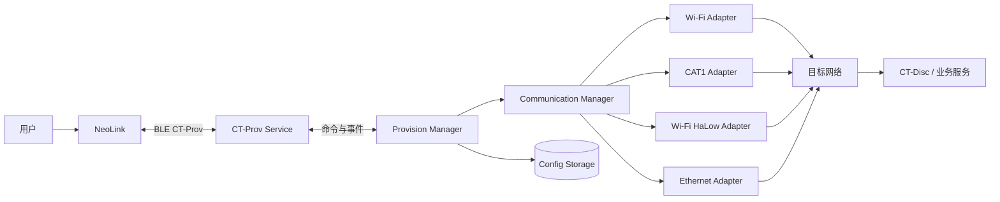
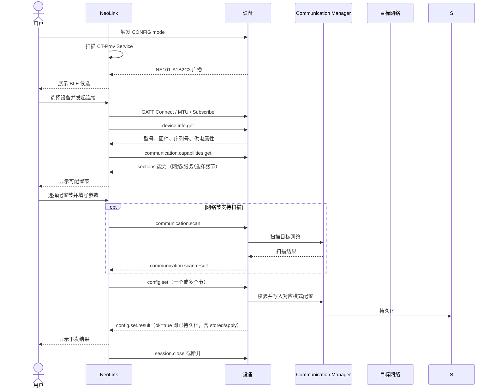
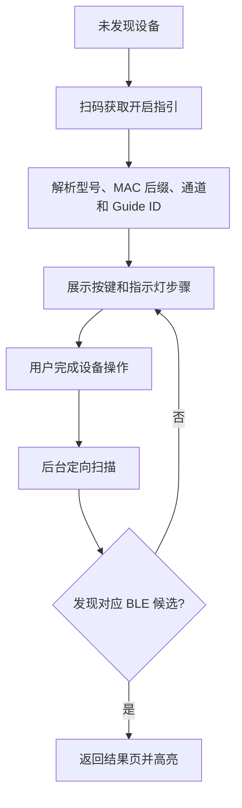
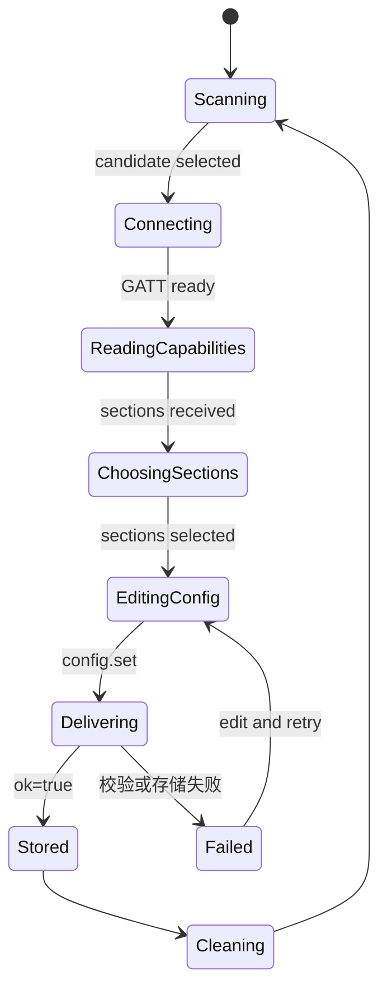
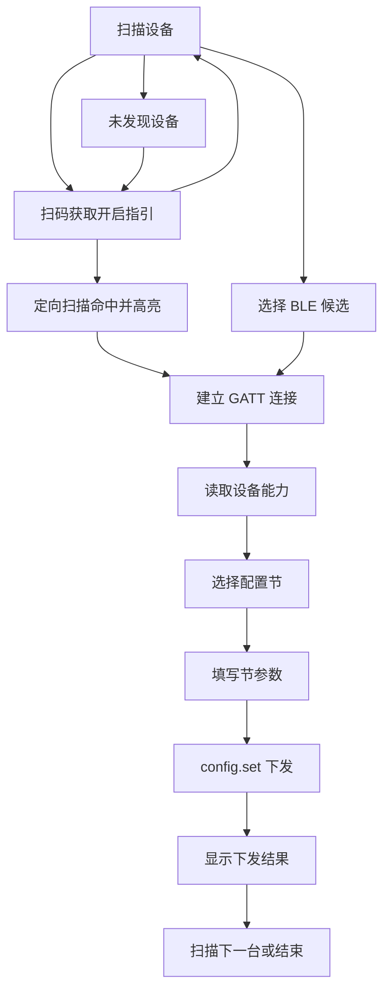

# NeoLink — BLE 扫描与通讯配置流程设计

| 项目 | 内容 |
| --- | --- |
| 所属项目 | NeoLink |
| 文档状态 | Draft v1.4，扫码并入扫描首页、指引命中后直接连接 |
| 更新日期 | 2026-10-29 |
| 首发目标 | NE101（ESP32-S3）BLE Peripheral MVP |
| 后续目标 | NE301（STM32N6570 + Si91x）复用同一流程 |
| BLE 协议 | CT-Prov/1 |

本文描述 NeoLink 通过 BLE 扫描设备、建立 GATT 配置连接，并按设备能力配置 Wi-Fi、CAT1、Wi-Fi HaLow 或 Ethernet 的流程。

总体产品流程见 [`NEOLINK_PRODUCT_FLOW.md`](./NEOLINK_PRODUCT_FLOW.md)，BLE 报文和状态定义见 [`CT_PROV_PROTOCOL.md`](./CT_PROV_PROTOCOL.md)，配置字段定义见 [`CT_CONFIG_SCHEMA.md`](./CT_CONFIG_SCHEMA.md)，未发现设备时使用的二维码见 [`CT_DEVICE_QR_SPEC.md`](./CT_DEVICE_QR_SPEC.md)。客户端工程边界见 [`NEOLINK_TECH_SELECTION.md`](./NEOLINK_TECH_SELECTION.md)。

## 1. 目标

BLE 子流程完成：

1. 扫描并展示附近 CT-Prov Peripheral。
2. 用户直接从结果中选择设备并发起连接，不要求先扫码。
3. 完成 GATT Service Discovery、订阅和设备信息读取。
4. 读取设备实际声明的配置节。
5. 按节能力扫描目标网络或显示配置表单。
6. 提交 `config.set` 并确认已写入持久化存储。
7. BLE 断线后重连，直接重发配置请求（幂等覆盖，无需查询）。
8. MQTT/Webhook 服务参数作为服务节在同一请求提交。
9. 完成或超时后清理当前任务数据。

二维码只在 BLE、AP 和 CT-Disc 均未发现设备时使用，用于展示设备进入 CONFIG mode 的操作指引。扫码后仍然必须重新扫描并由用户选择候选。

当前阶段不设计认证和安全机制。

## 2. 关键决策

| 编号 | 决策 |
| --- | --- |
| B-01 | BLE 是发现和配置传输通道，不等于设备最终通讯模式 |
| B-02 | 扫描到候选即可发起 GATT 连接 |
| B-03 | 通讯模式只能以连接后的 `communication.capabilities` 为准 |
| B-04 | Wi-Fi、CAT1、Wi-Fi HaLow、Ethernet 使用独立配置模型 |
| B-05 | PoE 作为 Ethernet 的供电属性，不作为协议模式 |
| B-06 | 配置下发无事务：`config.set` 幂等覆盖写，`ok=true` 即完成，不验证生效 |
| B-07 | 设备返回 `apply`（immediate/reconnect/reboot）作为应用时机提示，Client 不等待不轮询 |
| B-08 | 错误码只覆盖请求校验和存储失败；联网与服务运行结果不在协议反馈范围 |
| B-09 | App 不保存设备列表、IP、网络参数或历史结果 |
| B-10 | 服务（MQTT/Webhook）是普通配置节，与网络节同一 `config.set`，不单独成事务 |

## 3. 参与者与职责

| 参与者/模块 | 职责 |
| --- | --- |
| 用户 | 触发 CONFIG mode、选择设备、通讯模式和参数 |
| NeoLink | BLE 扫描、连接、能力驱动表单、配置下发和结果展示 |
| CT-Prov Service | 广播、GATT、分片、请求/响应和协议错误事件 |
| Provision Manager | 节校验、全有或全无写入、错误映射 |
| Communication Manager | 统一调度 Wi-Fi、CAT1、HaLow 和 Ethernet Adapter |
| Mode Adapter | 执行某一通讯模式的扫描、配置写入和应用 |
| Config Storage | 保存各节配置并按设备策略应用 |
| CT-Disc/业务服务 | 配置生效后的注册与业务连接（发生在配置协议之外） |

BLE Host 回调只处理分片、轻量校验和入队，不得同步等待网络扫描、CAT1 注册、DHCP 或业务服务。

## 4. 架构



`Communication Manager` 是上层唯一入口。CT-Prov Service 和 UI 不得直接依赖 ESP-IDF、Si91x、CAT1 模组或 Ethernet 驱动类型。

## 5. CONFIG 窗口

设备在以下条件打开窗口：

- 用户按键触发 CONFIG mode。
- 首次开机且没有可用通讯配置。
- 连续联网失败达到产品阈值。
- 受控的产测命令打开测试窗口。

窗口打开时：

1. 给出指示灯或声音反馈。
2. 启动 CT-Prov Peripheral 和广播。
3. 如产品支持，同时启动设备 AP。
4. 初始化 Provision Manager。
5. 从各 Mode Adapter 读取当前状态。

关闭条件：

- 用户退出 CONFIG mode。
- 窗口超时且没有活动连接。
- 当前任务完成并经过短结果读取宽限期。
- 出现必须重启的内部故障。

存在 BLE 连接、通讯扫描或配置写入时，旧 softAP 空闲定时器不能单独关闭整个配置窗口。

## 6. 正常流程



## 7. BLE 扫描和候选

NeoLink 只把同时满足以下条件的广播转换成 BLE 候选：

- 包含 CT-Prov Service UUID。
- Local Name 符合 `<MODEL>-<MAC_SUFFIX>`（9～17 字节）。
- Service Data 版本可识别。

候选展示：

- MAC 后缀。
- 型号提示（如果广播层可用）。
- RSSI。
- `PROVISIONABLE`。
- `BUSY`。
- 最近发现时间。

BLE 地址、iOS UUID 和 Windows Device ID 只作为当前平台连接句柄。相同型号与 MAC 后缀的多个结果保持独立，直到连接后读取到相同 `serial_number`。

## 8. 未发现设备和扫码引导

当所有扫描源在产品定义时间内均无结果时：



二维码不创建 BLE 连接，也不提供通讯能力。设备未出现时，NeoLink 必须停留在指引/扫描状态。

## 9. 连接顺序


要求：

- GATT 操作串行执行。
- 必须兼容 ATT MTU 23。
- D2C 订阅成功前不能发送应用请求。
- 发送第一个请求前必须完成配对加密（CT-Prov 4.4）。
- 读取能力失败时不能展示猜测的配置表单。
- 用户切换候选或通道时完整释放旧连接。

## 10. 能力驱动页面

NeoLink 根据返回的 `sections` 构建页面：

| 能力字段 | 页面行为 |
| --- | --- |
| `configurable=false` | 只显示状态，不允许提交 |
| `scannable=true` | 显示“扫描网络”入口 |
| `fields=[]` | 只显示写入确认操作 |
| `power` 包含 `poe` 且节为 `ethernet` | 显示“Ethernet（PoE 供电）” |
| `sections` 含 `mqtt` | 显示 MQTT 表单（启用、地址、端口、TLS、凭据、主题、QoS） |
| `sections` 含 `webhook` | 显示 Webhook 表单（启用、URL、签名密钥、请求头） |
| `sections` 含 `comm` | 显示网络类型切换选择器 |

模式兼容表只能用于提示旧固件升级，不能替代能力响应。

## 11. 四种通讯模式

### 11.1 Wi-Fi

流程：扫描 AP → 选择或输入 SSID → 填写密码 → 提交。

安全方式由设备根据是否提供密码推断；隐藏网络直接输入 SSID。提交前的本地校验覆盖 SSID 长度与密码长度（8～63）。

### 11.2 CAT1

流程：检查 SIM 状态 → 填写 APN/用户名/密码/PIN/认证 → 提交。

免配置 SIM 的设备可声明 `fields=[]`，页面只显示写入确认，不能伪造 APN 表单。

### 11.3 Wi-Fi HaLow

流程：扫描 HaLow 网络 → 选择网络 → 填写密码与区域码 → 提交。

HaLow 页面独立于普通 Wi-Fi。

### 11.4 Ethernet/PoE

流程：无表单字段，插线即用（DHCP）。

PoE 只显示供电属性。NeoLink 不修改交换机端口的 VLAN 和供电设置。

### 11.5 服务（MQTT/Webhook）

流程：填写服务参数 → 与网络节同一 `config.set` 提交 → `ok=true` 即完成。

Broker 连通性、回调可达性等运行效果由设备运行时自行处理，不在配置流程内反馈。

## 12. 下发语义与断线处理

配置写入是幂等覆盖：

1. NeoLink 提交 `config.set`，设备同步校验并持久化，返回 `config.set.result`。
2. `ok=true` 表示全部节已存储；任一节校验失败时整个请求不写入（全有或全无）。
3. BLE 断开不产生悬挂状态：设备侧要么已完整写入，要么完全不写入。
4. 重连后 NeoLink 直接重发相同请求，结果一致，无需查询旧事务。
5. 没有 `txid`、阶段状态事件、查询和取消操作；设备侧无需缓存事务结果。

## 13. 状态与完成条件



完成条件只有一个：`config.set.result` 的 `ok=true`。设备返回的 `apply`（immediate/reconnect/reboot）仅作为展示提示，NeoLink 不据此等待或轮询。

## 14. 页面流程



体验要求：

- 首页直接扫描，二维码不出现在正常成功路径中。
- “没有设备”“蓝牙不可用”“连接失败”“配置失败”使用不同页面状态。
- 设备只有一个可配置网络节时自动进入该节。
- CAT1 无表单字段时显示写入确认，不能伪造 SSID 页面。
- 结果页明确显示配置通道和目标通讯模式，例如“通过 BLE 配置 CAT1”。

## 15. NE101 接入

### 15.1 可复用能力

- CONFIG mode 与按键入口。
- softAP 和 `192.168.1.1` 页面。
- `net_module` 对 Wi-Fi、CAT1、Wi-Fi HaLow 的抽象。
- Wi-Fi GOT_IP 事件和现有 CT-Disc/注册链路。
- BLE Demo 的 Peripheral、GATT、Write 和 Notify 骨架。

### 15.2 需要新增

| 模块 | 改造 |
| --- | --- |
| `ct_prov_service` | 正式 UUID、广播、Indication、分片和 JSON 信封 |
| `provision_manager` | 节校验、全有或全无写入、错误映射 |
| `communication_manager` | 统一节能力和 Adapter 调度 |
| Wi-Fi Adapter | 网络扫描、配置写入与下次联网应用 |
| CAT1 Adapter | 配置写入与下次联网应用 |
| HaLow Adapter | 扫描、区域参数与配置写入 |
| Config Storage | 按节保存配置（NE101 复用 NVS 键值） |
| Service Manager | MQTT/Webhook 服务节存储 |
| `main` | 统一管理 BLE、softAP、HTTP 和 CONFIG 窗口 |

建议接口：

```c
typedef enum {
    CT_SECTION_WIFI,
    CT_SECTION_CELLULAR,
    CT_SECTION_HALOW,
    CT_SECTION_ETHERNET,
    CT_SECTION_COMM,
    CT_SECTION_MQTT,
    CT_SECTION_WEBHOOK,
} ct_section_t;

typedef enum {
    CT_APPLY_IMMEDIATE,
    CT_APPLY_RECONNECT,
    CT_APPLY_REBOOT,
} ct_apply_hint_t;

typedef struct {
    ct_section_t section;
    bool stored;
    ct_apply_hint_t apply;
} ct_config_result_t;
```

最终接口应避免在公共层暴露 ESP-IDF 专属类型。

## 16. NE301 接入

NE301 复用相同 CT-Prov 报文、节能力模型和 UI，只替换 BLE 与通讯 Adapter。

前置验证：

1. Si91x Peripheral/GATT Server、Indication 和广播。
2. Central + Peripheral 多角色并存。
3. BLE 与 Wi-Fi/HaLow 同 NCP 时的资源调度。
4. ATT MTU 23 下的完整分片互通。
5. Ethernet Link、DHCP/静态地址和可选 VLAN 状态。
6. PoE 供电信息如何由硬件层提供给 `device.info`。
7. CONFIG 窗口结束后原有 Central 角色和低功耗能否恢复。

如多角色不稳定，可以在 CONFIG 窗口内暂停 Central 扫描/连接，完成后恢复；不能因此改变上层协议。

## 17. 验收标准

### 17.1 扫描与连接

- 不扫码即可扫描、选择并连接 BLE 设备。
- 未发现设备时可以扫码查看指引，按指引操作后自动发现并高亮设备。
- MTU 23 下可完成设备信息、能力、扫描、配置和结果回传。
- 多台同型设备可以通过 MAC 后缀、RSSI 和用户确认区分。

### 17.2 通讯模式

- 至少覆盖 NE101（无 `comm` 节）与 NE301（含 `comm` 节）两种能力形态。
- Wi-Fi 和 HaLow 支持网络扫描与隐藏网络。
- CAT1 同时覆盖免配置 SIM 和手工 APN。
- Ethernet 以只读节展示并显示 PoE 供电属性。
- 设备声明 `mqtt`/`webhook` 节时可完成服务参数写入。
- 不支持的节和字段不会出现在可编辑页面。

### 17.3 下发与恢复

- `config.set` 成功返回 `stored` 节列表和 `apply` 提示。
- 任一节校验失败时整个请求不写入（全有或全无）。
- 相同请求重复提交结果一致（幂等覆盖）。
- BLE 在 `config.set` 发出后、响应返回前断开：重连重发不产生重复或半写入状态。
- 校验与存储错误码准确且可以指导用户修改。

### 17.4 数据与稳定性

- 离开结果页或重启 NeoLink 后不能恢复刚才的设备和配置记录。
- 连续配置 100 次无持续内存增长、死锁或 watchdog。
- BLE、设备 AP、通讯驱动、Camera 和低功耗共存无回归。

## 18. 建议实施顺序

1. 冻结配置节枚举、能力结构和状态机。
2. 将 NE101 BLE Demo 升级为 CT-Prov 分片和 JSON 请求/响应。
3. 先实现 `device.info`、`communication.capabilities` 和 Mock Adapter。
4. 依次接入 Wi-Fi、CAT1、Wi-Fi HaLow Adapter。
5. 实现全有或全无校验、幂等覆盖和断线重发。
6. 完成未发现设备、扫码指引和定向重扫页面。
7. 在 NE301 验证 Si91x Peripheral、多角色和 Ethernet/PoE。
8. 完成多平台、模式矩阵、资源、低功耗和异常回归。
