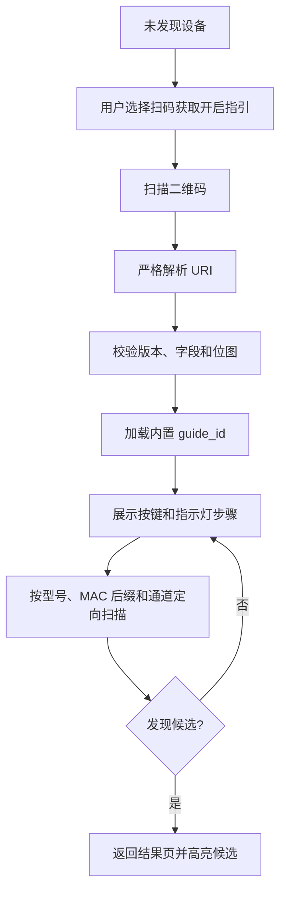
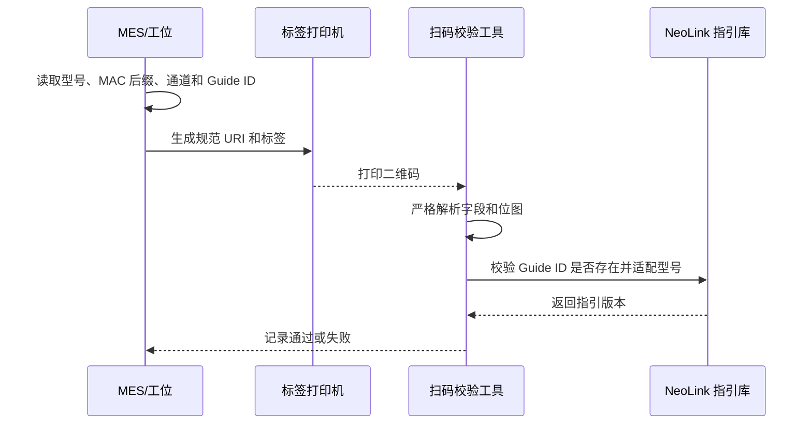

# CT Device Guide QR 规范

| 项目 | 内容 |
| --- | --- |
| 规范名称 | CT Device Guide QR |
| URI Scheme | `ctdev` |
| 当前版本 | `guide-v1` |
| 文档状态 | Draft v1.1 |
| 更新日期 | 2026-10-28 |
| 适用范围 | NeoLink、NE101、NE301 及后续兼容设备 |

## 1. 目的

CT Device Guide QR 用于在 NeoLink 没有扫描到设备时，识别设备型号并展示“如何让设备进入可发现/可配置状态”的操作指引。

二维码只提供：

- 设备型号提示。
- 设备型号与主 MAC 后缀，用于重新扫描时筛选和高亮候选。
- 设备可能支持的发现通道。
- NeoLink 内置操作指引的编号。

二维码不用于：

- 代替 BLE、设备 AP 或 CT-Disc 实时扫描。
- 直接建立连接。
- 决定设备实际支持的通讯模式。
- 携带 Wi-Fi、CAT1、Wi-Fi HaLow 或 Ethernet 配置。
- 携带任何认证、账号或平台凭证。

## 2. URI 格式

二维码内容必须是一个 UTF-8 URI：

```text
ctdev://guide-v1/<MAC_SUFFIX>?m=<MODEL>&c=<DISCOVERY_CHANNELS>&g=<GUIDE_ID>
```

示例：

```text
ctdev://guide-v1/A1B2C3?m=NE101&c=01&g=ne101_config_button_v1
```

生产端必须按示例字段顺序编码。解析端不得依赖查询参数顺序，但必须拒绝重复、缺失和未知字段。

## 3. URI 约束

| 项目 | 要求 |
| --- | --- |
| Scheme | 必须为小写 `ctdev` |
| Authority | 必须为小写 `guide-v1` |
| Path | 必须且只能包含一个 MAC_SUFFIX path segment |
| Query | 必须包含且只包含 `m`、`c`、`g` |
| Fragment | 禁止使用 |
| 字符集 | ASCII 子集，禁止空白、控制字符和百分号编码 |
| 最大长度 | 完整 URI 不得超过 128 字节 |

## 4. 字段定义

| 字段 | 格式 | 定义 |
| --- | --- | --- |
| `MAC_SUFFIX` | 6 位大写十六进制 | 设备规范主 MAC 最后 3 字节，与 BLE 广播 mac_suffix 和 device_name 后缀一致 |
| `m` | `[A-Z0-9_-]{1,16}` | 稳定的机器可读型号 |
| `c` | 2 位大写十六进制 | 发现/配置通道位图 |
| `g` | `[a-z0-9_-]{1,48}` | NeoLink 内置操作指引编号 |

这些字段都是发现提示。设备连接成功后，NeoLink 必须读取设备实际信息和通讯能力，不能以二维码为最终依据。

`m` 必须与设备规范型号一致；对支持 BLE 的设备，必须等于 CT-Prov `device_name` 的 MODEL 前缀（2～10 位 `A-Z0-9`），并与 `model_code` 的型号映射对应。

## 5. 发现通道位图 `c`

`c` 是 8 bit 无符号位图，以两位大写十六进制编码：

| Bit | 掩码 | 名称 | 含义 |
| ---: | ---: | --- | --- |
| 0 | `0x01` | `BLE` | 可能通过 BLE 被发现 |
| 1 | `0x02` | `ACCESS_POINT` | 可能广播设备 AP |
| 2 | `0x04` | `CT_DISC` | 可能通过当前 LAN 的 CT-Disc 被发现 |
| 3..7 | — | Reserved | 生产端置 0，解析端拒绝非 0 |

至少一个已知 bit 必须置位。PoE 不分配 bit，因为 PoE 是供电方式；通过 PoE 供电的设备仍然使用 CT-Disc/LAN 发现。

## 6. Guide ID

`g` 指向 NeoLink 安装包内置的版本化指引，不是远程 URL。指引内容至少包含：

- 适用型号和硬件版本范围。
- 设备通电检查。
- CONFIG 键的位置、按压方式和持续时间。
- 进入可发现状态后的指示灯或声音反馈。
- 建议等待时间。
- 失败后的恢复步骤。

示例：

```text
ne101_config_button_v1
ne301_ble_peripheral_v1
ne301_lan_discovery_v1
```

NeoLink 遇到未知 `guide_id` 时，应显示型号通用指引并允许重新扫描，不能打开任意外部地址。

## 7. 工具处理流程



处理顺序：

1. 校验 Scheme、Authority、总长度和 URI 结构。
2. 校验字段集合，拒绝未知、缺失或重复参数。
3. 校验 MAC 后缀、型号、位图保留位和 Guide ID。
4. 加载安装包内置指引。
5. 页面打开后继续后台扫描，不等待用户关闭指引。
6. 根据 `c` 只启用可能相关的定向扫描源。
7. 使用型号映射的 model_code 与 MAC 后缀筛选 BLE 候选（对应 Service Data 的 mac_suffix）；AP 与 CT-Disc 通道按产品定义的对应标识筛选。
8. 发现目标后返回扫描结果，由用户选择设备和配置通道。
9. 完成、取消或超时后清理二维码解析结果。

二维码解析成功不得直接创建 `ProvisioningConnection`，也不得直接进入通讯参数页面。

## 8. 禁止包含的信息

二维码不得包含：

- Wi-Fi SSID、密码或其他网络凭证。
- CAT1 APN 用户名、密码、SIM PIN 或运营商账号。
- Wi-Fi HaLow 密码。
- IP、掩码、网关、DNS、VLAN 或 DHCP 租约。
- BLE、Wi-Fi、HaLow 或 Ethernet MAC 地址。
- accessToken、OAuth token、binding ticket 或设备秘密。
- 用户、账号、租户和客户项目信息。
- 动态设备状态、当前 IP 或固件运行数据。
- 外部 URL 或可执行指令。

## 9. 标签要求

| 项目 | 要求 |
| --- | --- |
| 前景/背景 | 深色前景、纯浅色背景，禁止反色和渐变 |
| 纠错等级 | 建议 QR Error Correction Level Q |
| Quiet zone | 四周至少 4 modules |
| Module 尺寸 | 建议不小于 `0.4 mm`，以实际扫码工位验证为准 |
| Logo | 不得覆盖二维码模块 |
| 表面 | 避免高反光、强曲面和折痕 |

二维码旁建议打印：

```text
Model: NE101
MAC suffix: A1B2C3
Scan for setup help
```

## 10. 产线生成与校验



产线必须验证：

1. 型号、MAC 后缀与设备规范主 MAC 及外观标签一致。
2. `c` 只声明实际固件具备的发现通道。
3. `guide_id` 已包含在目标 NeoLink 版本中。
4. 打印后重新扫码并按本规范严格解析。
5. 按指引操作真实设备后，至少一个声明的扫描通道能够发现对应型号与 MAC 后缀的候选。

## 11. 一致性测试

至少覆盖：

- BLE、AP、CT-Disc 以及组合位图。
- 最短/最长合法型号和 Guide ID。
- 小写 MAC 后缀、非法十六进制和保留位。
- 缺失字段、重复字段、未知字段和额外 path segment。
- 超过 128 字节、空白、控制字符和百分号编码。
- 未知版本和未知 Guide ID。
- 扫码后目标立即出现、延迟出现和始终未出现。
- 相同型号与 MAC 后缀的多通道候选仍由用户选择。

生产端、NeoLink 移动端、NeoLink 桌面端和产线扫码工具必须共享同一组测试向量。
