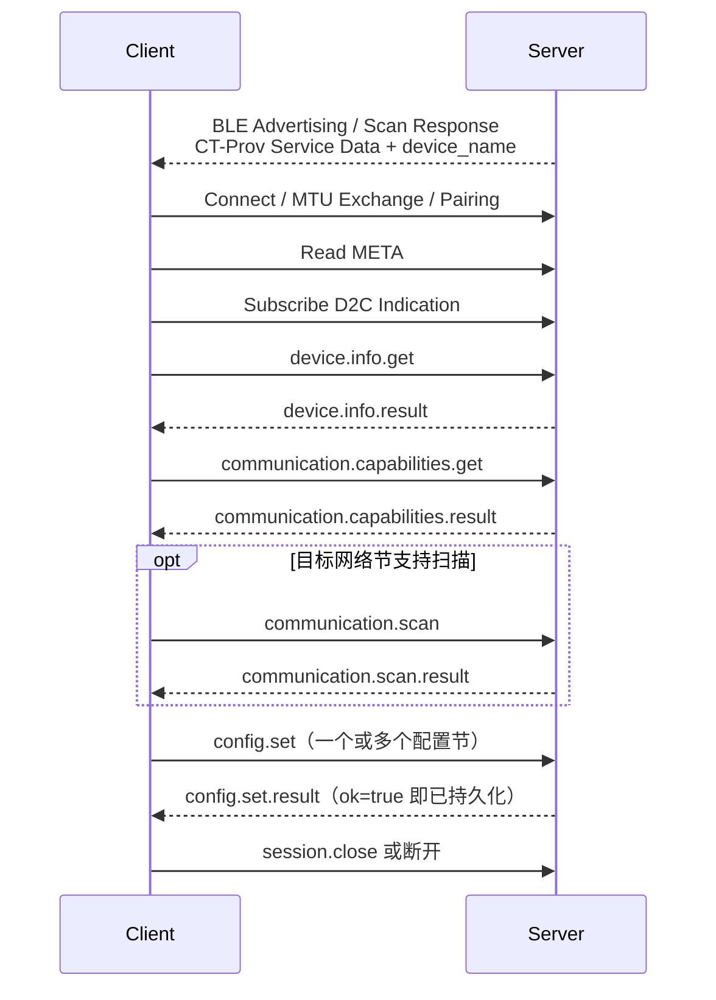
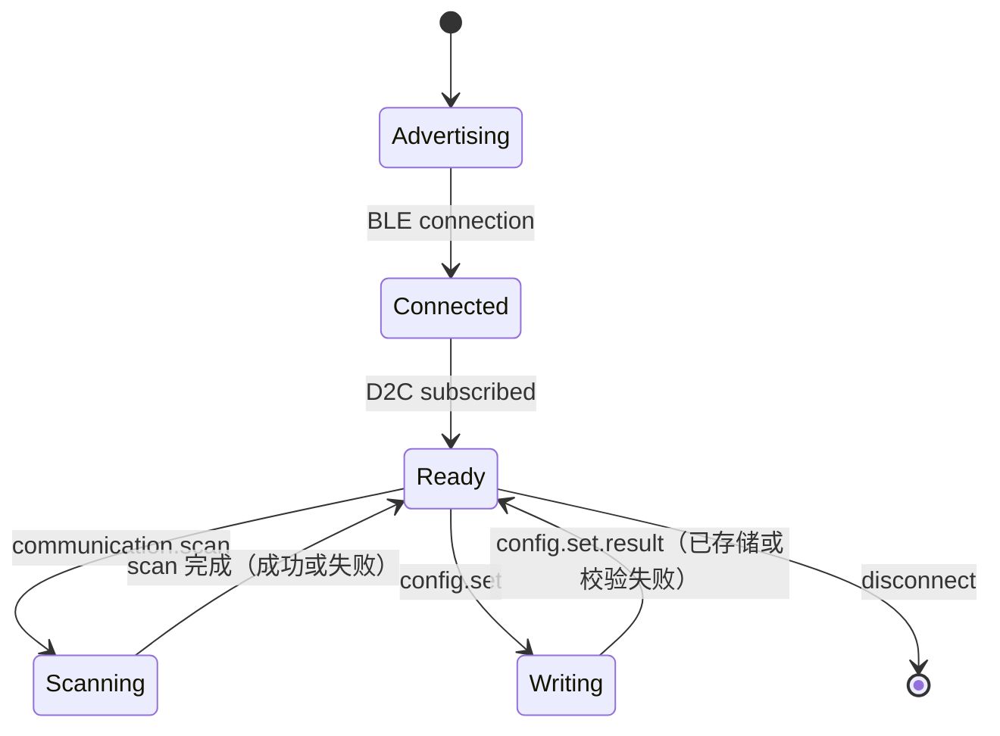

# CT-Prov/1 BLE 通讯配置协议规范

| 项目 | 值 |
| --- | --- |
| 文档状态 | Draft v2.0，交互简化为无事务配置下发模型 |
| 协议版本 | CT-Prov/1 |
| 更新日期 | 2026-10-28 |
| 适用范围 | CT-Prov BLE Client 与 Server |
| 编码 | BLE GATT + 二进制分片头 + UTF-8 JSON |

本文中的“必须”“禁止”“应该”“可以”分别表示强制要求、强制禁止、推荐要求和可选能力。

## 1. 目标与边界

CT-Prov 是 BLE 上的设备通讯配置协议。它负责：

1. 发现 CT-Prov Server 并建立 GATT 连接。
2. 读取设备信息和实际配置能力。
3. 扫描支持扫描的目标网络。
4. 把 Wi-Fi、蜂窝（CAT1）、Wi-Fi HaLow 或 Ethernet 的配置参数和 MQTT、Webhook 服务参数写入设备并持久化。
5. 以请求-响应方式确认配置已下发（已接收并存储）。

CT-Prov/1 不负责：

- 验证配置是否生效：协议不反馈网络连接进度、地址获取、Broker 连接或 Webhook 探测结果。配置写入即完成，实际联网效果由设备本地 Web、设备状态页面或云平台侧确认。
- 事务跟踪：没有 `txid`、完成条件、阶段状态事件、查询和取消。配置写入是幂等的覆盖写，重复提交相同配置没有额外副作用。
- 规定 NeoLink 页面、设备按键的位置/外观、指示灯或二维码格式。
- 规定设备如何进入可发现状态。
- 规定设备 AP 或 CT-Disc 的传输协议。
- 规定云端账号、绑定 API 或设备管理功能。
- 通过 BLE 传输图片、视频、OTA 包或大文件。
- 把 PoE 当作独立通讯协议；PoE 设备使用 `ethernet` 节。
- 定义应用层认证、加密和访问控制；这些能力留给后续版本。链路层加密要求见 4.4。
- 定义静态 IP 配置。NE101 与 NE301 当前实现均为 DHCP，静态地址由后续版本按需扩展。
- 规定 MQTT 主题体系、Webhook 载荷格式和事件枚举内容；这些由产品文档定义。

本文只定义分片与信封格式、操作交互和设备状态模型。`config.set` 载荷中各配置节的字段定义、约束和示例见 [`CT_CONFIG_SCHEMA.md`](./CT_CONFIG_SCHEMA.md)。

CT-Prov/1 不引入 Setup ID、配网码或其他新的设备编号。Advertising Data 使用型号枚举和设备规范主 MAC 的后 3 字节作为本地发现提示，Scan Response 复用设备已有的 `device_name`；建立连接后通过设备已有的 `serial_number` 获取完整身份信息。

## 2. 角色与术语

| 名称 | 定义 |
| --- | --- |
| Client | 发起通讯配置的一方，BLE Central / GATT Client |
| Server | 接收通讯配置的一方，BLE Peripheral / GATT Server |
| Configuration window | Server 允许被扫描、连接和配置的时间窗口 |
| Connection | 一次 BLE GATT 连接 |
| Discovery transport | NeoLink 找到并连接设备的通道；本文固定为 BLE |
| Config section | `config.set` 中的顶层配置节，如 `wifi`、`cellular`、`mqtt`；节名与能力声明一一对应 |
| Network section | 决定设备如何联网的配置节：`wifi`、`cellular`、`halow`、`ethernet` |
| Service section | 决定设备把数据发到哪里的配置节：`mqtt`、`webhook`；依赖某个网络节可用后才会实际生效 |
| Delivery | 配置已通过加密链路写入 Server 持久化存储；`config.set.result` 的 `ok=true` 即为下发确认 |
| Capability | Server 对某配置节公开的实际可写字段 |
| Device name | 设备已有的短名称，用于扫描结果显示和连接引导，不是设备身份 |
| Model code | 广播中使用的 1 字节型号枚举，只用于扫描阶段的型号提示 |
| MAC suffix | 设备规范主 MAC 地址的最后 3 字节，只用于本地扫描结果区分 |
| Serial number | 设备已有的完整序列号，建立连接后读取 |

配置节名枚举：

```text
wifi  cellular  halow  ethernet  comm  mqtt  webhook
```

`comm` 为可选节，仅用于支持显式选择网络类型的设备。

## 3. 总体流程



Client 必须在写入配置前读取能力。不得只依据设备型号或本地兼容表构造 `config.set` 请求。

## 4. BLE Profile

### 4.1 UUID

| 对象 | UUID | GATT 属性 | 方向 |
| --- | --- | --- | --- |
| CT-Prov Service | `7B1E0001-9D5B-4B5B-8F6D-2A4C0B7E0100` | Primary Service | — |
| C2D Characteristic | `7B1E0002-9D5B-4B5B-8F6D-2A4C0B7E0100` | Write | Client → Server |
| D2C Characteristic | `7B1E0003-9D5B-4B5B-8F6D-2A4C0B7E0100` | Indicate | Server → Client |
| META Characteristic | `7B1E0004-9D5B-4B5B-8F6D-2A4C0B7E0100` | Read | Server → Client |

CT-Prov 使用 Write Request 和 Indication。Client 必须先完成配对加密（见 4.4），订阅 D2C 后再发送请求。

协议必须兼容 ATT MTU 23。协商更大 MTU 只用于提升效率，不能成为功能正确性的前提。Server 同时只处理一个 CT-Prov 配置连接。出现第二个配置连接时，Server 对其所有请求必须返回 BUSY，且其 META 的 flags 必须置 BUSY=1；是否在链路层直接拒绝第二个连接由实现决定。Client 对 BUSY=1 的候选应显示为不可配置，不得自动连接。

### 4.2 广播

CT-Prov/1 使用 Legacy Advertising。Advertising Data 和 Scan Response 各自不得超过 31 字节。本节中的长度均包含 AD Structure 的 Length 和 AD Type 字节。

#### 4.2.1 设备名称

`device_name` 使用设备已有名称，不新增产线字段。CT-Prov/1 约束名称为：

```text
<MODEL>-<MAC_SUFFIX>
```

其中：

- `MODEL` 为 2～10 位大写字母或数字。
- `MAC_SUFFIX` 为设备规范主 MAC 地址最后 3 字节，使用 6 位大写十六进制字符。
- 完整名称必须为 9～17 字节 ASCII，只允许 `A-Z`、`0-9` 和 `-`。
- 设备必须从已有工厂信息或持久化配置读取同一个 `device_name`；禁止按 BLE、Wi-Fi 和 Ethernet 的运行时接口 MAC 分别生成名称。
- MODEL 前缀必须与 device.info 返回的 `model` 字段一致，并符合 `model_code` 的型号映射。

示例：

```text
NE101-A1B2C3
NE301-84C102
```

`device_name` 只用于显示和连接引导。Client 禁止使用它执行认证、授权、资产绑定或全局去重；完整身份必须在连接后通过 `serial_number` 获取。

#### 4.2.2 Advertising Data

Advertising Data 必须包含以下两个 AD Structure：

1. Flags：General Discoverable、BR/EDR Not Supported。
2. Service Data - 128-bit UUID：CT-Prov Service UUID 和 CT-Prov discovery payload。

不得同时加入 Complete 128-bit Service UUID List；CT-Prov Service UUID 已包含在 Service Data 中。

整体布局：

| AD Structure | 长度 | 内容 |
| --- | ---: | --- |
| Flags | 3 | `02 01 06` |
| Service Data - 128-bit UUID | 24 | CT-Prov UUID 16 字节 + discovery payload 6 字节 |
| 合计 | 27 | 剩余 4 字节不发送 |

Advertising Data 绝对偏移：

| 偏移 | 长度 | 字段 | 说明 |
| ---: | ---: | --- | --- |
| 0 | 1 | Flags Length | 固定 `0x02` |
| 1 | 1 | Flags AD Type | 固定 `0x01` |
| 2 | 1 | Flags Value | 固定 `0x06` |
| 3 | 1 | Service Data Length | 固定 `0x17`，表示后续 23 字节 |
| 4 | 1 | Service Data AD Type | 固定 `0x21`，Service Data - 128-bit UUID |
| 5 | 16 | `service_uuid` | CT-Prov Service UUID，按 BLE 小端字节序发送 |
| 21 | 1 | `format_version` | 广播格式版本，CT-Prov/1 固定 `0x01` |
| 22 | 1 | `model_code` | 型号枚举 |
| 23 | 3 | `mac_suffix` | 设备规范主 MAC 地址的最后 3 字节，按显示顺序发送 |
| 26 | 1 | `flags` | 发现状态位图，见下表 |

首版 `model_code`：

| 值 | 型号 |
| ---: | --- |
| `0x00` | 未定义，禁止用于正式设备 |
| `0x01` | NE101 |
| `0x02` | NE301 |
| `0x03..0xFE` | 后续分配 |
| `0xFF` | 保留 |

Client 不得仅因无法识别 `model_code` 而隐藏或拒绝设备；在 `format_version` 可解析时，仍应显示 `mac_suffix`、保留 Scan Response 名称并允许连接。Client 遇到不支持的 `format_version` 时不得继续解释 discovery payload 的后续字段，但仍可以按 Service Data UUID 展示候选并尝试连接，通过 GATT 协商协议能力。

`flags`：

| Bit | 名称 | 含义 |
| ---: | --- | --- |
| 0 | `BUSY` | 正在执行其他配置连接，当前不能接受新的配置会话 |
| 1 | `PROVISIONABLE` | 当前允许发起配置 |
| 2..7 | Reserved | Server 置 0，Client 忽略 |

`BUSY=1` 时 `PROVISIONABLE` 必须为 0。

设备规范主 MAC 必须是每台设备稳定且由产品规范唯一选定的 48-bit MAC。不得使用可能变化的 BLE 随机地址，也不得按 BLE、Wi-Fi、HaLow 或 Ethernet 的当前接口分别选择。`mac_suffix` 必须与 `device_name` 末尾的 `MAC_SUFFIX` 完全一致。使用稳定主 MAC 后缀意味着广播可被长期关联和追踪；CT-Prov/1 接受这一权衡以换取本地可发现性，地址随机化由后续版本考虑。

CT-Prov Service UUID：

```text
7B1E0001-9D5B-4B5B-8F6D-2A4C0B7E0100
```

Advertising Data 中的 UUID 字节序：

```text
00 01 7E 0B 4C 2A 6D 8F 5B 4B 5B 9D 01 00 1E 7B
```

示例设备：

```text
format_version = 0x01
model_code     = 0x01
mac_suffix     = A1:B2:C3
flags          = 0x02  // PROVISIONABLE
```

完整 Advertising Data：

```text
02 01 06
17 21
00 01 7E 0B 4C 2A 6D 8F 5B 4B 5B 9D 01 00 1E 7B
01 01 A1 B2 C3 02
```

Client 必须按 Service Data 的 UUID 识别 CT-Prov Server，不得只查询 Complete Service UUID List。平台支持 Service Data 过滤时可以直接使用；不支持时必须在前台执行宽泛扫描，再从扫描结果的 Service Data 中按 UUID 过滤。CT-Prov/1 不保证这种布局支持平台后台 Service UUID 过滤。

#### 4.2.3 Scan Response

Scan Response 必须包含：

1. Complete Local Name：`device_name`。

布局：

| 字段 | 长度 | 说明 |
| --- | ---: | --- |
| Length | 1 | `1 + N`，包含 AD Type，不包含 Length 自身 |
| AD Type | 1 | 固定 `0x09`，Complete Local Name |
| `device_name` | N | 9～17 字节 ASCII，不包含结尾 NUL |

例如 `device_name="NE101-A1B2C3"` 时：

```text
0D 09 4E 45 31 30 31 2D 41 31 42 32 43 33
```

Client 应执行主动扫描以获取 Scan Response，但不得假定每次扫描结果都包含名称。名称暂时缺失时，Client 应根据 `model_code` 和 `mac_suffix` 生成临时显示名称并继续使用系统 Peripheral Handle 连接；收到 Scan Response 后再以 `device_name` 更新显示。

### 4.3 META Characteristic

META Characteristic 使用以下二进制结构：

| 偏移 | 长度 | 字段 | 说明 |
| ---: | ---: | --- | --- |
| 0 | 1 | `protocol_version` | 固定 `0x01` |
| 1 | 1 | `flags` | 与 Advertising Data 的 `flags` 位定义相同 |
| 2 | 1 | `name_length` | `device_name` 字节数，范围 `9..17` |
| 3 | N | `device_name` | ASCII，不包含结尾 NUL |

META 总长度不得超过 20 字节，以保证在 ATT MTU 23 下可通过一次 Read Response 返回。META 中的 `device_name` 必须与 Scan Response 中的 Complete Local Name 完全一致。

### 4.4 链路安全与配对

CT-Prov/1 不定义应用层认证和访问控制，但配置请求携带网络凭证，因此必须使用 BLE 链路层加密：

- Server 必须把 C2D 和 D2C 配置为需要加密链路；未加密的访问必须被 ATT 层以 Insufficient Authentication 拒绝。
- META 读取允许在未加密链路上进行。
- Client 必须在发送第一个请求前完成配对并加密链路。配对算法由平台协商，最低要求 Just Works 加密，推荐 LE Secure Connections。
- 配对必须使用无绑定（no bonding）模式：每次连接重新协商密钥，Server 不得持久化配对密钥，配置窗口结束或连接断开后立即丢弃。移动端 App 无法查询或删除系统绑定，设备恢复出厂后残留的旧密钥会导致无法程序化恢复的加密失败；无绑定模式同时避免批量配置时手机端绑定累积和设备端绑定表溢出。

威胁模型：链路加密防止配置窗口内的被动嗅探者获取网络或服务凭证；Just Works 不防御主动中间人。设备身份认证、凭证轮换和应用层访问控制由后续协议版本定义。

## 5. GATT 分片层

每次 C2D Write 或 D2C Indication 的 Attribute Value 由 5 字节分片头和数据组成：

| 偏移 | 长度 | 字段 | 说明 |
| ---: | ---: | --- | --- |
| 0 | 1 | `magic_version` | 固定 `0xC1` |
| 1 | 1 | `packet_kind` | 逻辑包类型 |
| 2 | 1 | `message_id` | 每个方向独立递增，模 256 |
| 3 | 1 | `fragment_index` | 从 0 开始 |
| 4 | 1 | `fragment_count` | `1..255` |
| 5 | N | `fragment_payload` | UTF-8 JSON 的一部分 |

`packet_kind`：

| 值 | 名称 | 用途 |
| ---: | --- | --- |
| `0x01` | `REQUEST` | Client 请求 |
| `0x02` | `RESPONSE` | Server 对请求的直接响应 |
| `0x03` | `EVENT` | Server 异步事件（本版本仅 `protocol.error`） |
| `0x7F` | `PROTOCOL_ERROR` | 无法关联请求的协议错误 |

`PROTOCOL_ERROR` 使用 6.4 的异步事件信封：

```json
{
  "seq": 2,
  "event": "protocol.error",
  "data": {
    "code": "INVALID_MESSAGE",
    "message": "fragment reassembly timeout"
  }
}
```

`code` 取自 12 公共错误码。任一方无法把收到的分片组装为合法逻辑包，或收到无法关联到任何请求的非法消息时，可以发送 `PROTOCOL_ERROR`，并必须终止当前组包。

单片最大数据长度：

```text
fragment_payload_max = ATT_MTU - 3 - 5
```

要求：

- 每个方向同一时刻只组装一个逻辑包；发送端必须写完一个逻辑包的全部分片后再开始下一个，不得交错。
- 建立连接时两个方向的 `message_id` 从 0 开始。
- 分片必须按 `fragment_index` 递增发送。
- 除最后一片外，其余分片应使用 `fragment_payload_max`。
- 乱序、缺片、重复片或头部字段变化必须终止当前组包。
- 逻辑包最大 4096 字节（fragment_payload 总和，不含分片头）。ATT MTU 23 下受 fragment_count 上限约束，实际最大 3825 字节；达到 4096 上限需协商 MTU ≥ 25。
- 组包超时 3 秒。
- 接收端必须在分配缓冲区前检查片数和长度。
- 接收端遇到 magic_version 非 0xC1 或未知 packet_kind 的分片时，必须丢弃当前组包缓冲，不得崩溃；可用 PROTOCOL_ERROR 上报 INVALID_MESSAGE。

## 6. JSON 信封

JSON 使用 UTF-8，顶层必须为 object，禁止 BOM。字段名区分大小写；整数不得用浮点数表达。

### 6.1 请求

```json
{
  "id": 12,
  "op": "communication.capabilities.get",
  "data": {}
}
```

| 字段 | 类型 | 约束 |
| --- | --- | --- |
| `id` | uint32 | 当前连接内由 Client 分配；进行中的请求不得重复 |
| `op` | string | 本规范定义的操作名 |
| `data` | object | 操作参数 |

### 6.2 成功响应

```json
{
  "id": 12,
  "op": "communication.capabilities.result",
  "ok": true,
  "data": {}
}
```

### 6.3 失败响应

```json
{
  "id": 12,
  "op": "communication.capabilities.result",
  "ok": false,
  "error": {
    "code": "UNSUPPORTED_OPERATION",
    "message": "operation is not supported"
  }
}
```

`message` 只用于显示和诊断，业务逻辑必须使用稳定的 `code`。失败响应的 `op` 为对应请求操作的 `.result` 形式。

### 6.4 异步事件

本版本唯一的异步事件是 `protocol.error`（见 5）。

```json
{
  "seq": 8,
  "event": "protocol.error",
  "data": {}
}
```

`seq` 是当前连接内单调递增的 uint32，模 2^32 回绕后继续递增，同连接内不得回退。接收方收到无法关联到任何在途请求的响应 `id` 时必须忽略该响应。

## 7. 设备信息

请求：

```json
{
  "id": 1,
  "op": "device.info.get",
  "data": {}
}
```

响应：

```json
{
  "id": 1,
  "op": "device.info.result",
  "ok": true,
  "data": {
    "device_name": "NE101-A1B2C3",
    "serial_number": "NE101202610270001",
    "model": "NE101",
    "firmware": "1.8.0",
    "power": ["battery"],
    "protocol_version": 1
  }
}
```

规则：

- `device_name`、`serial_number`、`model`、`firmware`、`power` 和 `protocol_version` 为必填字段。
- `device_name` 必须与 META 及 Scan Response 中的名称一致；其 MODEL 前缀必须等于本响应的 `model` 字段，并符合广播 `model_code` 的型号映射。
- `serial_number` 直接映射设备已有出厂 SN，不得由 Client 根据名称、MAC 或其他字段推导。
- `model` 是设备型号的权威值；Client 可以在扫描阶段从 `model_code` 取得型号提示，但连接后必须以本字段为准。
- `serial_number` 用于当前连接内确认设备身份。CT-Prov 不要求 Client 在连接结束后保存它。
- `power` 的已知值为 `battery`、`external`、`poe`。PoE 只描述供电能力。

## 8. 配置能力

请求操作：`communication.capabilities.get`。

响应示例（NE301 形态，含可选 `comm` 节）：

```json
{
  "id": 2,
  "op": "communication.capabilities.result",
  "ok": true,
  "data": {
    "sections": [
      {
        "name": "wifi",
        "kind": "network",
        "configurable": true,
        "scannable": true,
        "fields": ["ssid", "password", "bssid"]
      },
      {
        "name": "cellular",
        "kind": "network",
        "configurable": true,
        "fields": ["apn", "username", "password", "pin", "auth", "roaming"]
      },
      {
        "name": "halow",
        "kind": "network",
        "configurable": true,
        "scannable": true,
        "fields": ["ssid", "password", "country"]
      },
      {
        "name": "ethernet",
        "kind": "network",
        "configurable": false,
        "fields": []
      },
      {
        "name": "comm",
        "kind": "selector",
        "configurable": true,
        "fields": ["type"]
      },
      {
        "name": "mqtt",
        "kind": "service",
        "configurable": true,
        "fields": ["enable", "host", "port", "client_id", "username", "password", "tls", "topic", "qos"]
      },
      {
        "name": "webhook",
        "kind": "service",
        "configurable": true,
        "fields": ["enable", "url", "secret", "header"]
      }
    ],
    "current": {
      "network": "wifi"
    }
  }
}
```

规则：

- Server 只返回本机固件实际实现并可持久化的节和字段。NE101 不返回 `comm` 节（网络类型由固件探测决定）；NE101 的 `wifi` 节不含 `bssid`，`cellular` 节不含 `roaming`。
- `kind` 取值：`network`（联网方式）、`service`（数据出口）、`selector`（显式选择网络类型）。
- `fields` 决定 `config.set` 可提交的字段和页面表单项；未列出的字段不得提交。
- `scannable=true` 的网络节支持 `communication.scan`。
- `configurable=false` 的节只读展示，`config.set` 写入该节返回 `SECTION_NOT_SUPPORTED`。
- 未识别的 `name` 必须隐藏或显示为不可配置，不能按其他节猜测。
- `current.network` 为当前活动网络节名；从未配置过时为 `null`。该字段仅用于展示，不作为写入 `service` 节的前置校验。
- 服务节（`mqtt`、`webhook`）可在任何时刻写入；实际生效依赖某个网络节联网成功，协议不做该依赖的校验或反馈。

## 9. 网络扫描

只有能力声明 `scannable=true` 的网络节支持扫描。

请求：

```json
{
  "id": 3,
  "op": "communication.scan",
  "data": {
    "section": "wifi"
  }
}
```

响应：

```json
{
  "id": 3,
  "op": "communication.scan.result",
  "ok": true,
  "data": {
    "section": "wifi",
    "items": [
      {
        "network_id": "Office-2.4G",
        "display_name": "Office-2.4G",
        "signal": -48,
        "channel": 6
      }
    ],
    "more": false,
    "cursor": ""
  }
}
```

Wi-Fi HaLow 使用相同信封，但 `section=halow`，条目可以增加 `country`、`bandwidth_khz` 等已声明字段。

分页：单页最多 32 项。请求 `data` 可携带 `cursor`（首次扫描省略）；响应 `data` 在 `more=true` 时携带下一页 `cursor`，`more=false` 时 `cursor` 为空字符串。`cursor` 对 Client 不透明，仅在当前连接内有效，跨连接或过期后 Server 返回 `INVALID_ARGUMENT`。

Server 正在写入配置时收到 `communication.scan`，必须返回 `BUSY`。

蜂窝运营商搜索不使用本操作，首版由 modem 自动注册；以后需要时定义专属操作。

## 10. 配置下发

操作：`config.set`。`data` 是「配置节名 → 节对象」的映射，一次可写入一个或多个节：

```json
{
  "id": 20,
  "op": "config.set",
  "data": {
    "wifi": {
      "ssid": "Office-2.4G",
      "password": "example-password"
    },
    "mqtt": {
      "enable": true,
      "host": "mqtt.example.com",
      "port": 8883,
      "username": "device",
      "password": "example-secret",
      "tls": true
    }
  }
}
```

响应：

```json
{
  "id": 20,
  "op": "config.set.result",
  "ok": true,
  "data": {
    "stored": ["wifi", "mqtt"],
    "apply": "reconnect"
  }
}
```

语义：

- **下发即完成**：`ok=true` 表示请求中全部节已通过校验并写入持久化存储。协议到此为止，不验证配置生效，不反馈联网进度，不订阅后续状态。
- **部分写**：仅 `data` 中出现的节被写入；未出现的节保持不变。
- **节内整对象替换**：节内字段整体覆盖，不做字段级合并。清除某字段按该节 schema 的缺省语义处理。
- **幂等覆盖**：重复提交相同请求得到相同结果（再次覆盖写），无额外副作用。没有 `txid`；BLE 断线重连后 Client 直接重发 `config.set` 即可，无需查询旧事务。
- **`apply` 仅为提示**：`immediate`（立即应用）、`reconnect`（下次联网时应用）、`reboot`（重启后应用）由设备实现决定，Client 只作展示，不得据此等待或轮询。
- 提交规则：能力未声明的节返回 `SECTION_NOT_SUPPORTED`；能力未声明的字段返回 `FIELD_NOT_SUPPORTED`；字段类型、范围或组合非法返回 `INVALID_ARGUMENT`；持久化失败返回 `STORAGE_FAILED`。任一节校验失败时整个请求不写入（全有或全无）。
- 密码类字段（Wi-Fi/蜂窝/MQTT 密码、Webhook secret）只能在加密链路传输（见 4.4），且遵循 schema 的长度上限。
- 字段定义、约束和各节示例见 [`CT_CONFIG_SCHEMA.md`](./CT_CONFIG_SCHEMA.md)。

读取当前已存配置（可选操作 `config.get`）：

```json
{
  "id": 21,
  "op": "config.get",
  "data": {}
}
```

响应 `data` 为「节名 → 当前持久化值」映射，结构与 `config.set` 的节对象相同；密码类字段由实现决定返回掩码。不支持 `config.get` 的设备返回 `UNSUPPORTED_OPERATION`。

## 11. 会话关闭

```json
{
  "id": 32,
  "op": "session.close",
  "data": {}
}
```

```json
{
  "id": 32,
  "op": "session.close.result",
  "ok": true,
  "data": {}
}
```

`session.close` 永远成功。Server 返回该响应后必须主动断开连接。Client 直接断开连接同样是合法的会话结束方式，效果等同于 `session.close`。

## 12. 错误码

| 错误码 | 含义 |
| --- | --- |
| `INVALID_MESSAGE` | JSON 或信封非法 |
| `UNSUPPORTED_VERSION` | 协议版本不支持 |
| `UNSUPPORTED_OPERATION` | 操作不支持 |
| `INVALID_ARGUMENT` | 参数类型、范围或组合非法 |
| `BUSY` | Server 正在处理其他连接或扫描 |
| `SECTION_NOT_SUPPORTED` | 配置节不支持或不可配置 |
| `FIELD_NOT_SUPPORTED` | 请求包含能力未声明的字段 |
| `STORAGE_FAILED` | 配置持久化失败 |
| `INTERNAL_ERROR` | 未归类内部错误 |

错误码只覆盖请求校验和存储失败。网络关联、DHCP、Broker 连接、Webhook 推送等运行时结果不属于本协议反馈范围，由设备自身日志、本地 Web 或平台侧呈现。

## 13. 超时和资源上限

| 项目 | 推荐值 |
| --- | ---: |
| BLE 连接 | 15 秒 |
| 请求响应（含 config.set 持久化） | 10 秒 |
| 分片组包 | 3 秒 |
| Wi-Fi/HaLow 扫描 | 20 秒 |

其他限制：

- 同时进行中的请求最多 4 个；`config.set` 写入期间 Server 可拒绝并发扫描（BUSY）。
- 扫描结果单页最多 32 项。
- JSON 字符串默认最大 256 字节；密码类字段最大 128 字节。
- 数组项和嵌套深度必须有实现上限。
- Server 回调不得同步阻塞等待网络驱动或存储完成以外的操作。

## 14. 状态机



`Writing` 只覆盖「校验 + 持久化」窗口；写入完成后设备立即回到 `Ready`，可继续接受下一次 `config.set` 或断开。设备内部按新配置重连网络、连接 Broker 等行为发生在协议状态机之外。

## 15. 互操作和一致性测试

至少覆盖：

- Advertising Data 的 27 字节固定布局、AD Type、Length、UUID 字节序和 discovery payload 偏移。
- Service Data 的 `format_version`、全部已知及未知 `model_code`、`mac_suffix` 和保留 flag 位。
- `BUSY` 与 `PROVISIONABLE` 的组合约束，以及保留 flag 位的忽略规则。
- Service Data 平台过滤和前台应用层过滤；禁止只依赖 Complete Service UUID List。
- Scan Response 名称长度、字符集、缺失 Scan Response、META 长度和 META/Scan Response 名称一致性。
- `mac_suffix` 与 `device_name` 后缀一致，且不得来自 BLE 随机地址。
- `device.info` 中 `device_name`、`serial_number` 和 `model` 的必填与一致性检查。
- 不把 `device_name` 当作全局唯一标识，不依据名称自动合并不同 Peripheral Handle。
- ATT MTU 23 和较大 MTU。
- 单片、多片、最大消息、乱序、缺片、重复片和组包超时。
- 请求 ID 关联、事件序号、未知操作和非法 JSON。
- 能力声明：网络/服务/选择器三类节；NE101 无 `comm` 节、NE301 有 `comm` 节两种形态。
- `config.set`：单节写、多节写、部分写不触碰未列出的节、节内整对象替换。
- `config.set` 校验失败全有或全无：任一节非法时已校验节也不得写入。
- 未声明节返回 `SECTION_NOT_SUPPORTED`；未声明字段返回 `FIELD_NOT_SUPPORTED`；类型和范围错误返回 `INVALID_ARGUMENT`。
- 重复提交相同 `config.set` 结果一致（幂等覆盖），断线重连后重发不产生异常状态。
- `apply` 三种取值仅作展示，Client 不等待不轮询。
- `config.get`（如支持）：返回值与最近一次 `config.set` 的持久化结果一致；密码掩码行为一致。
- 服务节在无活动网络时也可写入成功。
- BLE 在 `config.set` 请求发出后、响应返回前断开：设备侧要么完整写入要么完全不写入，重连后重发结果一致。
- 配对与加密：未加密链路写入 C2D 被拒绝；配对加密后完整流程通过；同一手机重复配置恢复出厂后的设备不需要手动删除系统绑定。
- `session.close` 响应后主动断开；直接断开与会话关闭等效。
- `PROTOCOL_ERROR` 载荷解析与组包终止。
- 扫描分页 `cursor` 多页拉取、跨连接失效返回 `INVALID_ARGUMENT`。
- `device_name` 的 MODEL 前缀与 `device.info.model` 及 `model_code` 映射一致。

NE101、NE301 和 NeoLink 必须共享同一组 JSON、分片和状态机 Golden Vector。

## 16. 参考文档

- [CT-Prov/1 配置数据结构](./CT_CONFIG_SCHEMA.md)
- [NeoLink 产品与流程](./NEOLINK_PRODUCT_FLOW.md)
- [BLE 流程设计](./BLE_PROVISIONING_FLOW_DESIGN.md)
