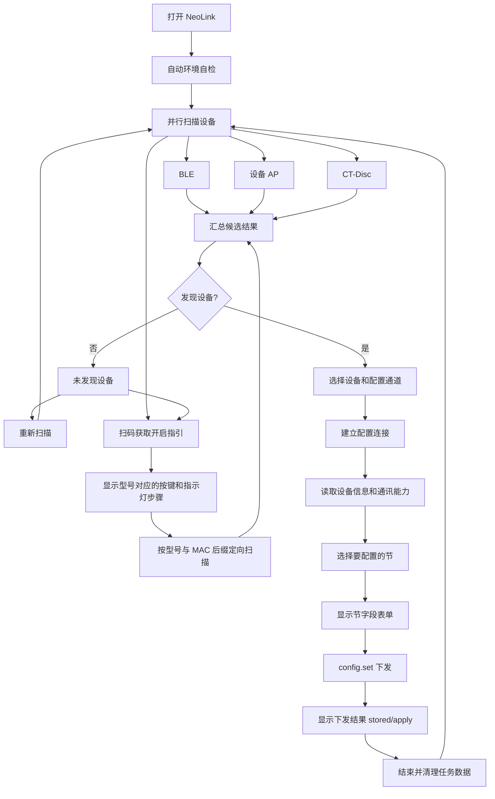
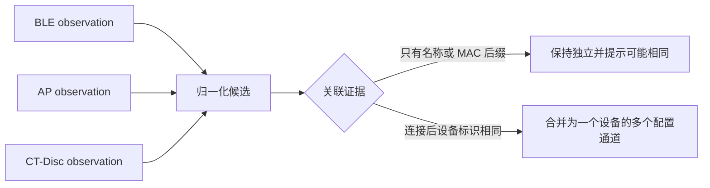

# NeoLink 产品与设备通讯配置流程

| 项目 | 内容 |
| --- | --- |
| 软件名称 | NeoLink |
| 产品形态 | 桌面端与移动端设备扫描、连接和通讯配置工具 |
| 文档状态 | Draft v1.5，扫码并入扫描首页并贯通指引到连接 |
| 更新日期 | 2026-10-29 |
| 首发设备 | NE101、NE301 |

## 1. 产品定义

NeoLink 是一个无设备库的现场工具。它通过 BLE、设备 AP 和 CT-Disc 扫描当前可达设备，用户选择设备后建立配置通道，读取设备实际支持的通讯模式，并完成对应参数配置。

设备的发现方式与最终通讯方式是两个独立维度：

| 维度 | 可选项 | 回答的问题 |
| --- | --- | --- |
| 发现/配置通道 | BLE、设备 AP、CT-Disc | NeoLink 如何找到设备并向其发送配置 |
| 目标通讯模式 | Wi-Fi、CAT1、Wi-Fi HaLow、Ethernet | 设备配置完成后通过什么方式联网 |

例如，NeoLink 可以通过 BLE 发现设备并配置其 CAT1，也可以通过设备 AP 配置 Wi-Fi HaLow。PoE 是 Ethernet 的供电属性，不是独立网络协议；产品界面显示为“Ethernet（PoE 供电）”。

当前阶段不讨论认证、加密和访问控制。相关能力以后作为独立协议版本设计，不能影响当前扫描、能力读取和通讯配置模型。

## 2. 产品边界

NeoLink 当前负责：

1. 启动时自动完成本机环境自检（蓝牙、Wi-Fi AP 枚举、网卡与权限），完成即进入扫描；某通道受限时降级该通道并标注，不影响其余通道。
2. 并行扫描 BLE、设备 AP 和当前局域网中的 CT-Disc 设备。
3. 展示临时候选设备及其发现来源。
4. 由用户选择设备和配置通道。
5. 建立配置连接并读取设备通讯能力。
6. 根据能力动态显示 Wi-Fi、CAT1、Wi-Fi HaLow 或 Ethernet 配置表单，以及可选的 MQTT/Webhook 服务表单。
7. 提交配置并确认设备已持久化存储（不验证联网生效）。
8. 未发现设备时，通过二维码展示设备进入可发现状态的操作指引。
9. 任务完成、取消、超时或应用退出后清理设备信息。

NeoLink 当前不负责：

- 不保存设备资产、历史设备、收藏或别名。
- 不维护设备长期在线状态。
- 不承担设备日常控制、媒体查看、OTA 或批量管理。
- 不保证跨 VLAN 自动发现设备。
- 不通过 PoE 决定交换机端口所在的网络或 VLAN。
- 不把二维码作为正常扫描、连接或通讯配置的必要步骤。

## 3. 核心对象

### 3.1 扫描候选 `DiscoveryCandidate`

候选只存在于当前扫描任务：

| 字段 | 含义 |
| --- | --- |
| `candidate_id` | 当前任务内随机 ID |
| `model_hint` | 广播、SSID 或 CT-Disc 返回的型号提示 |
| `mac_suffix` | 主 MAC 后 3 字节（6 位十六进制），用于区分附近同型设备 |
| `discovery_channels` | 已观察到的 BLE、AP、CT-Disc 来源 |
| `signal` | BLE RSSI、AP 信号或 LAN 可达状态 |
| `interface` | CT-Disc 响应所在网卡和网段 |
| `provisionable` | 当前是否处于可配置状态 |
| `busy` | 是否正在执行其他配置任务 |
| `last_seen` | 当前任务中的最后发现时间 |

候选不是设备资产。相同名称、MAC 后缀或 IP 不足以在扫描阶段自动合并结果。

### 3.2 配置连接 `ProvisioningConnection`

用户选择候选和通道后创建一次临时连接：

| 字段 | 含义 |
| --- | --- |
| `candidate_id` | 来源候选 |
| `transport` | `ble`、`access_point` 或 `ct_disc` |
| `state` | connecting、connected、closed |
| `device_info` | 连接后读取的型号、固件版本和设备标识 |
| `capabilities` | 设备实际支持的通讯模式与配置能力 |

### 3.3 配置能力 `CapabilitySection`

设备以配置节数组声明实际能力：

```text
sections[]（wifi / cellular / halow / ethernet / comm / mqtt / webhook）
├── name
├── kind          network | service | selector
├── configurable
├── scannable     仅部分网络节为 true
├── fields        本机固件实际可持久化的字段
└── current.network   当前活动网络节（仅展示）
```

网络节首版枚举：`wifi`、`cellular`（NE101 侧称 CAT1）、`halow`、`ethernet`。`comm` 为可选选择器节，仅显式切换网络类型的设备声明；NE101 由固件按硬件探测决定网络类型，不声明该节。

### 3.4 配置载荷 `ConfigPayload`

配置请求是「节名 → 节对象」映射，一次 `config.set` 可写入一个或多个节；未出现的节保持不变，节内字段整体替换：

```text
ConfigPayload
├── wifi: WifiSection
├── cellular: CellularSection
├── halow: HalowSection
├── comm: CommSection（可选）
├── mqtt: MqttSection
└── webhook: WebhookSection
```

各节字段约束见 [`CT_CONFIG_SCHEMA.md`](./CT_CONFIG_SCHEMA.md)。

### 3.5 服务节（mqtt / webhook）

服务是普通配置节（`kind=service`），与网络节在同一 `config.set` 提交。实际生效依赖某个网络节联网成功，配置工具不做该依赖的校验或反馈。

## 4. 总体流程



扫码入口位于扫描首页（相机或图片导入），未发现设备页的入口返回扫描首页打开同一扫码面板。二维码解析成功后进入操作指引页并定向扫描，命中目标后由用户确认连接；不能凭二维码直接跳到连接或配置页面。

## 5. 设备扫描

### 5.1 BLE

BLE 扫描条件：

- CT-Prov Service UUID。
- Local Name `<MODEL>-<MAC_SUFFIX>`，例如 `NE101-A1B2C3`。
- Service Data 中的协议版本、model_code、MAC 后缀、BUSY 和 PROVISIONABLE 状态。

结果显示型号提示、MAC 后缀、RSSI、可配置状态和“BLE”来源。操作系统提供的 BLE 地址或 UUID 只作为当前连接句柄。

### 5.2 设备 AP

设备 AP SSID 使用（`<MAC_SUFFIX>` 为主 MAC 后 3 字节的 6 位十六进制，与 BLE 广播一致）：

```text
CT-AP-<MAC_SUFFIX>
```

平台允许枚举附近 AP 时直接生成候选。平台不允许枚举时，应显示系统能力限制，并允许用户打开系统 Wi-Fi 页面；不能把“无法扫描”显示为“没有设备”。

### 5.3 CT-Disc

NeoLink 在用户允许的物理网卡上发送 CT-Disc：

- 记录响应来自哪个接口和网段。
- 默认降低 VPN、容器和虚拟网卡的优先级。
- 同一响应在不同网卡出现时分别显示。
- 明确提示 CT-Disc 通常只能覆盖当前广播域或 VLAN。

### 5.4 扫描结果聚合



候选超过 `last_seen` 阈值后从页面移除，不形成离线设备记录。

## 6. 未发现设备与扫码指引

扫描超时后显示“未发现设备”，但后台可以继续低频扫描。页面提供：

- 重新扫描。
- 检查蓝牙、Wi-Fi 和本地网络权限。
- 选择设备型号查看操作方法。
- 扫码获取设备开启指引（返回扫描首页的扫码面板）。

二维码遵循 [`CT_DEVICE_QR_SPEC.md`](./CT_DEVICE_QR_SPEC.md)，只提供型号、MAC 后缀、发现通道和指引编号。NeoLink 根据 `guide_id` 打开内置指引，例如：

1. 确认设备通电。
2. 长按 CONFIG 键指定时间。
3. 等待指示灯进入规定状态。
4. NeoLink 在页面后台按型号与 MAC 后缀继续定向扫描。
5. 发现目标后自动返回结果页并高亮候选。

用户也可以点击“我已完成，重新扫描”。

## 7. 建立配置连接

“连接”在三个通道中的含义：

| 通道 | 建立配置连接 |
| --- | --- |
| BLE | 建立 GATT、发现 CT-Prov Service、读取 META、订阅事件 |
| 设备 AP | 本机加入目标 AP，确认 Provisioning API 可达 |
| CT-Disc | 选择响应地址和网卡，建立配置事务上下文 |

连接成功后必须先读取 `device.info` 和 `communication.capabilities`。二维码、型号兼容表和扫描广播只能作为页面提示，不能替代连接后返回的实际能力。

## 8. 通讯模式配置

### 8.1 Wi-Fi

可能的配置项：

- 扫描并选择 SSID，或输入隐藏网络。
- 密码；省略表示开放网络，安全方式由设备推断。

### 8.2 CAT1

可能的配置项：

- SIM PIN。
- APN；免配置物联网卡可声明 `fields=[]`，页面只显示写入确认。
- APN 用户名、密码和认证方式。
- 漫游开关（设备声明该字段时）。

### 8.3 Wi-Fi HaLow

可能的配置项：

- 网络标识（SSID）。
- 密码；省略表示开放网络。
- 国家/区域代码。

### 8.4 Ethernet/PoE

无表单字段：插线即用（DHCP）。PoE 只作为 `power=poe` 能力展示。交换机端口的 VLAN、PoE 标准和供电策略不由 NeoLink 配置。

### 8.5 服务（MQTT/Webhook）

设备能力声明 `mqtt`/`webhook` 节时，可在同一配置请求提交数据出口参数：

- MQTT：启用开关、Broker 地址、端口、TLS、凭据、Client ID、上报主题和 QoS。
- Webhook：启用开关、回调 URL、签名密钥和附加请求头。

服务节写入成功即完成（存储确认）；Broker 连通性、回调可达性等运行效果由设备本地或平台侧确认，配置工具不做实测。

## 9. 下发结果

配置提交是单一请求-响应：`config.set` → `config.set.result`。

| 响应 | 含义 |
| --- | --- |
| `ok=true` + `stored` | 全部节已校验并写入持久化存储；`stored` 列出已写入节名 |
| `apply` | 应用时机提示：`immediate`、`reconnect`、`reboot`，由设备实现决定，仅展示 |
| `ok=false` + 错误码 | 校验失败（节/字段不支持、参数非法）或存储失败；整个请求不写入 |

不做联网验证：不反馈链路、地址或服务连通进度。重复提交相同配置为幂等覆盖，断线重连后直接重发。结果页展示已写入节、apply 提示和（失败时）错误码，离开页面后立即清理。

## 10. 页面结构

| 页面 | 主要内容 | 主要动作 |
| --- | --- | --- |
| 环境自检 | 蓝牙、Wi-Fi AP 枚举、网卡与权限检测结果（启动自动执行） | 重新检测、进入扫描 |
| 扫描首页 | 三路扫描状态、实时结果、扫码面板（相机或图片导入） | 选择设备、刷新、扫码 |
| 未发现设备 | 权限/距离/配置模式提示 | 重试、扫码获取开启指引 |
| 操作指引 | 按键、指示灯和动画步骤 | 后台定向扫描、手工重试 |
| 设备候选 | 发现来源、MAC 后缀、信号和网卡 | 选择配置通道 |
| 建立连接 | 通道连接过程 | 取消、重试、切换通道 |
| 配置节 | 设备实际声明的节 | 选择网络/服务节 |
| 参数配置 | 节字段表单 | 提交配置 |
| 服务配置 | MQTT/Webhook 表单（能力声明 `mqtt`/`webhook` 节时） | 提交服务节 |
| 下发结果 | 已写入节、apply 提示和错误 | 重试、打开 Web、扫描下一台 |

## 11. 错误模型

| 错误域 | 示例 |
| --- | --- |
| 系统能力 | 蓝牙关闭、AP 扫描受限、本地网络权限拒绝 |
| 扫描 | 超时、无结果、广播受限、网卡不可用 |
| 连接 | GATT 失败、AP 加入失败、CT-Disc 地址失效 |
| 能力 | 设备没有可配置节、版本不支持 |
| 参数校验 | 字段类型或范围非法、字段组合冲突 |
| 节/字段门控 | 节不支持（`SECTION_NOT_SUPPORTED`）、字段未声明（`FIELD_NOT_SUPPORTED`） |
| 存储 | 持久化失败（`STORAGE_FAILED`） |

联网、DHCP、Broker 连接、Webhook 推送等运行时结果不属于配置工具的反馈范围，由设备本地或平台侧呈现。“未发现设备”“设备连接失败”“配置下发失败”是三个不同阶段，不能统一显示成同一个错误。

## 12. 数据生命周期

| 数据 | 是否落盘 | 生命周期 |
| --- | --- | --- |
| 扫描候选、RSSI、SSID、IP 和来源网卡 | 否 | 当前扫描任务 |
| 二维码指引字段 | 否 | 当前发现引导任务 |
| 设备信息与通讯能力 | 否 | 当前配置连接 |
| Wi-Fi、CAT1、HaLow 和 IP 表单数据 | 否 | 当前配置事务 |
| MQTT/Webhook 表单、密码和签名密钥 | 否 | 当前配置事务 |
| 本次结果和 `web_url` | 否 | 当前结果页 |
| 语言、主题和默认扫描网卡 | 可以 | 工具设置，不关联设备 |

当前版本不实现设备数据库。管理功能以后作为独立产品能力设计。

## 13. 设备能力基线

| 能力 | NE101 | NE301 | NeoLink 行为 |
| --- | --- | --- | --- |
| BLE 配置通道 | ESP32-S3 需完成正式 CT-Prov | Si91x 需补 Peripheral 并验证多角色 | 统一显示为 BLE 候选 |
| 设备 AP | 已有 softAP 和 `192.168.1.1` | 以实际固件能力为准 | 能枚举时加入扫描结果 |
| CT-Disc | 可复用现有链路 | 可用于 LAN/Ethernet 设备发现 | 显示网卡和网段 |
| Wi-Fi | 复用 `net_module` | 通过 Si91x 适配 | 使用 Wi-Fi 表单 |
| CAT1 | 复用 `net_module` 对应实现 | 以 SKU 为准 | 使用 CAT1 表单 |
| Wi-Fi HaLow | 复用 `net_module` 对应实现 | 以 SKU 为准 | 使用 HaLow 表单 |
| Ethernet/PoE | 当前无 Ethernet | 以 Ethernet 硬件和固件为准 | PoE 作为供电属性展示 |

## 14. 推进阶段

| 阶段 | 交付物 | 退出条件 |
| --- | --- | --- |
| M0 产品模型 | 候选、连接、通讯能力、配置联合类型、二维码指引 | Mock 流程全部通过 |
| M1 NE101 | BLE/AP 扫描连接，至少两种通讯模式适配 | Windows、Android、iOS 实机闭环 |
| M2 NE301 | Si91x BLE Peripheral、CT-Disc、Ethernet/PoE 能力 | 多角色、多网卡和配置结果回传通过 |
| M3 产品化 | 安装包、权限引导、兼容矩阵和低功耗回归 | 不保存设备历史，量产门禁通过 |

## 15. 文档地图

- [`CT_DEVICE_QR_SPEC.md`](./CT_DEVICE_QR_SPEC.md)：未发现设备时使用的操作指引二维码。
- [`CT_PROV_PROTOCOL.md`](./CT_PROV_PROTOCOL.md)：BLE 上的通用通讯配置协议。
- [`CT_CONFIG_SCHEMA.md`](./CT_CONFIG_SCHEMA.md)：配置节字段定义与 NE101/NE301 平台映射。
- [`BLE_PROVISIONING_FLOW_DESIGN.md`](./BLE_PROVISIONING_FLOW_DESIGN.md)：BLE 扫描、连接和通讯配置子流程。
- [`BLE_PROV_DEMO.md`](./BLE_PROV_DEMO.md)：NE101 BLE Peripheral/GATT 最小实验。
- [`NEOLINK_TECH_SELECTION.md`](./NEOLINK_TECH_SELECTION.md)：桌面端与移动端技术选型。
- [`neolink_ui_mockup.html`](./neolink_ui_mockup.html)：可交互 UI 原型。
