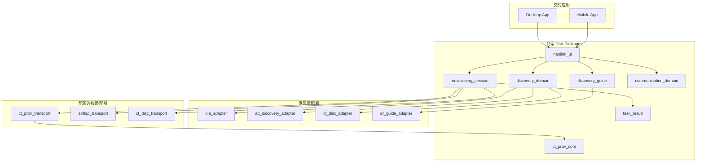
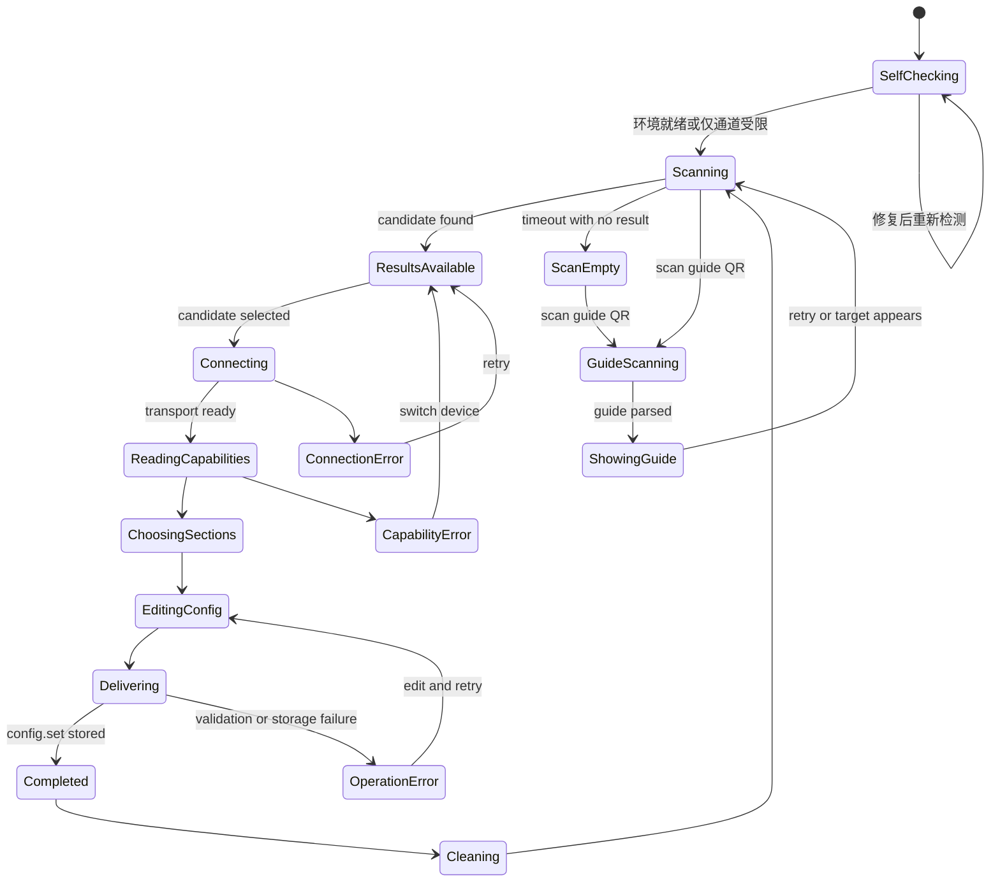

# NeoLink 桌面端与移动端技术设计

| 项目 | 内容 |
| --- | --- |
| 文档状态 | Draft v1.5，扫码并入扫描首页并贯通指引到连接 |
| 更新日期 | 2026-10-29 |
| 适用范围 | Windows、Android、iOS、macOS、Linux |
| 平台优先级 | Windows 桌面端 > 移动端（Android、iOS）> 其他桌面端 |
| 推荐方案 | Flutter/Dart 双应用同仓 + 共享领域层 + 平台通道适配器 |
| 桌面备用方案 | Tauri + Rust BLE/LAN Adapter |

本文定义 NeoLink 客户端的工程结构、跨平台边界和验证门禁。平台优先级决定交付和验证顺序：Windows 桌面端首发，移动端第二阶段，macOS 与 Linux 随后。产品流程见 [`NEOLINK_PRODUCT_FLOW.md`](./NEOLINK_PRODUCT_FLOW.md)，BLE 协议见 [`CT_PROV_PROTOCOL.md`](./CT_PROV_PROTOCOL.md)，二维码指引见 [`CT_DEVICE_QR_SPEC.md`](./CT_DEVICE_QR_SPEC.md)。

## 1. 结论

Windows 桌面端是首发交付平台。桌面端和移动端使用两个独立 Flutter 应用，共享纯 Dart 领域包和大部分 UI 组件：

- 桌面端：Windows 10/11（P0，首发），macOS、Linux 随后。
- 移动端：Android、iOS（P1，第二阶段）。

优先级只改变交付和验证顺序，不改变架构：领域层保持平台无关，Windows 版是参考实现，也是 BLE 插件门禁的首个执行平台；移动端复用已冻结的领域对象、协议 Codec 和测试向量，不重复设计。

领域层必须明确拆分：

1. 设备发现通道：BLE、设备 AP、CT-Disc。
2. 配置连接：通过某个发现通道建立临时会话。
3. 目标通讯模式：Wi-Fi、CAT1、Wi-Fi HaLow、Ethernet。
4. 节配置：能力驱动的独立表单与节对象（`wifi`/`cellular`/`halow`/`comm`/`mqtt`/`webhook`）。
5. 配置下发：单次 `config.set` 请求-响应，幂等覆盖写，不做生效验证。

二维码不属于正常连接依赖。它只在未发现设备时解析为 `DiscoveryGuide`，用于展示操作步骤并启动定向重扫。

当前工具不建立设备数据库，不持久化候选、设备信息、通讯配置或结果。管理能力只保留未来扩展边界。

## 2. 平台范围

| 优先级 | 平台 | 首版要求 |
| --- | --- | --- |
| P0 | Windows 10/11 | BLE/AP/CT-Disc 三路扫描、多网卡、扫码图片导入、四模式与服务配置动态表单 |
| P1 | Android、iOS | BLE、受平台能力限制的 AP 扫描、同 LAN CT-Disc、扫码指引、四模式与服务配置动态表单 |
| P2 | macOS | 与 P0 相同，增加签名、公证和权限适配 |
| P3 | Ubuntu、Debian | 完成 BlueZ/DBus、多网卡和安装依赖验证后发布 |
| 后续 | Web | 单独评估 Web Bluetooth 和浏览器网络限制 |

选择 Windows 首发的工程理由：

- 现场配置最依赖的能力（多网卡选择、CT-Disc 广播域、扫码图片导入、打开 `web_url`）在桌面端不受移动系统权限限制。
- BLE 栈风险最高的平台先过门禁：若 Windows BLE 不达标，切换 Tauri + Rust 备用方案的决策发生在首发平台冻结之前，返工成本最低。

“Flutter 支持某平台”不代表 BLE、Wi-Fi 扫描或摄像头插件满足项目要求，所有关键能力必须通过实机门禁。

## 3. 能力基线

客户端必须：

1. 独立启动、停止和刷新 BLE、AP、CT-Disc 扫描源。
2. 将不同来源归一化为当前任务的 `DiscoveryCandidate`。
3. 区分“扫描不到”和“平台不允许扫描”。
4. 允许用户选择候选和配置通道。
5. 建立连接后读取设备信息和配置节能力。
6. 使用联合类型表达各配置节的对象结构。
7. 根据节 `fields`、`scannable` 和 `configurable` 动态构建页面。
8. 以幂等覆盖写提交配置，断线重连后直接重发。
9. 区分扫描、连接、能力、校验和存储错误。
10. 未发现设备时解析指引二维码并后台定向重扫。
11. 完成、超时或退出时释放扫描、连接和临时数据。

## 4. 总体架构



依赖方向保持单向：UI 依赖领域层，领域层依赖接口，平台 Adapter 实现接口。领域对象不得直接暴露第三方插件类型。

## 5. 建议仓库结构

```text
neolink/
├── apps/
│   ├── desktop_app/
│   └── mobile_app/
├── packages/
│   ├── discovery_domain/
│   ├── discovery_guide/
│   ├── provisioning_session/
│   ├── communication_domain/
│   ├── ct_prov_core/
│   ├── ble_adapter/
│   ├── ap_discovery_adapter/
│   ├── softap_transport/
│   ├── ct_disc_adapter/
│   ├── qr_guide_adapter/
│   ├── task_result/
│   ├── neolink_ui/
│   └── test_vectors/
└── tooling/
```

`desktop_app` 是首发入口；移动端与桌面端使用独立入口与发布配置，但共享领域对象、协议 Codec、状态机和测试向量。

## 6. 核心类型

### 6.1 枚举

```dart
enum DiscoveryChannel { ble, accessPoint, ctDisc }

enum CommunicationMode {
  wifi,
  cat1,
  wifiHalow,
  ethernet,
}
```

禁止使用同一个 `channel` 字段同时表示发现通道和通讯模式。

### 6.2 发现接口

```dart
abstract interface class DiscoveryAdapter {
  DiscoveryChannel get channel;
  Stream<DiscoveryObservation> scan(ScanOptions options);
  Future<void> stop();
}

final class DiscoveryCandidate {
  final String candidateId;
  final String? modelHint;
  final String macSuffix;
  final Set<DiscoveryChannel> channels;
  final bool provisionable;
  final bool busy;
  final DateTime lastSeen;
}
```

原始 observation 由 `discovery_domain` 归一化。Android MAC、iOS UUID、SSID 和 IP 都只是 Adapter 内连接定位信息。

### 6.3 配置连接接口

```dart
abstract interface class ProvisioningTransport {
  DiscoveryChannel get channel;

  Future<ProvisioningSession> connect(
    DiscoveryCandidate candidate,
  );
}

abstract interface class ProvisioningSession {
  Stream<ProtocolError> get errors;
  Future<DeviceInfo> getDeviceInfo();
  Future<List<CapabilitySection>> getCapabilities();
  Future<List<NetworkObservation>> scanNetwork(String section);
  Future<DeliveryResult> applyConfig(Map<String, ConfigSection> sections);
  Future<Map<String, ConfigSection>> getConfig();
  Future<void> close();
}

enum ApplyHint { immediate, reconnect, reboot }

final class DeliveryResult {
  final List<String> stored;
  final ApplyHint apply; // 仅展示，不据此等待或轮询
}
```

`applyConfig` 是纯请求-响应：`ok=true` 即已持久化，没有事务句柄和查询接口。BLE、设备 AP、CT-Disc 都实现同一会话语义，但底层传输协议可以不同。

### 6.4 配置节联合类型

```dart
sealed class ConfigSection {
  const ConfigSection();
}

final class WifiSection extends ConfigSection { /* ssid, password, bssid? */ }
final class CellularSection extends ConfigSection { /* apn, username, password, pin, auth, roaming? */ }
final class HalowSection extends ConfigSection { /* ssid, password, country? */ }
final class CommSection extends ConfigSection { /* type */ }
final class MqttSection extends ConfigSection { /* enable, host, port, client_id, ... */ }
final class WebhookSection extends ConfigSection { /* enable, url, secret?, header? */ }
```

节专属字段只能存在于对应子类型中；同一请求可混合网络节与服务节。服务凭据（MQTT 密码、Webhook 签名密钥）只存在于当前配置请求内存，遵守与网络密码相同的数据生命周期。

## 7. 桌面端技术栈（P0：Windows 10/11）

### 7.1 Windows 10/11（P0，首发）

| 层级 | 选择 | 用途 |
| --- | --- | --- |
| UI | Flutter Desktop | Windows 独立构建，参考实现入口 |
| BLE | `universal_ble` 候选 | 真实适配器和睡眠恢复测试 |
| AP | 平台网络 API | SSID 枚举、加入和路由恢复 |
| LAN | `dart:io` Socket | 网卡枚举和 CT-Disc |
| 二维码图片 | 文件选择器 + 图片解码 | 无摄像头时的正式路径 |
| 二维码相机 | 跨平台扫码插件候选 | 增强能力，需要独立 PoC |
| 本地 Web | 系统默认浏览器 | 打开本次结果中的 `web_url` |

Windows 首发必须验证：

- BLE Cache 和适配器驱动重启场景。
- Wi-Fi、Ethernet、VPN、虚拟网卡并存时的接口选择与展示。
- 扫码图片导入作为正式兜底路径可用。
- BLE 门禁不达标时，桌面端切换到 Tauri + Rust BLE Adapter，领域模型和协议测试向量保持不变。

### 7.2 macOS（P2）

与 Windows 相同的功能基线，另需完成签名、公证，以及蓝牙、相机和本地网络权限适配。

### 7.3 Ubuntu、Debian（P3）

完成 BlueZ/DBus、普通用户权限和安装依赖（`.deb`/AppImage/Flatpak 取舍）验证后发布。

## 8. 移动端技术栈（P1：Android、iOS）

移动端第二阶段交付，复用 Windows 已冻结的领域层与测试向量；BLE 插件结论可以从 Windows 平移，但 Android/iOS 的权限和配对行为仍需实机门禁。

| 层级 | 选择 | 用途 |
| --- | --- | --- |
| UI | Flutter Stable + Material 3 | 固定 SDK 版本并经过设备回归 |
| 状态管理 | Riverpod + 显式状态机 | 管理扫描、连接和事务生命周期 |
| 路由 | `go_router` | 扫描、空结果、指引、候选、连接、模式、配置和结果页 |
| BLE | `universal_ble` 候选 | 通过 Adapter 隔离，PoC 后冻结；PoC 需验证加密特征访问、隐式配对与 no-bonding 行为 |
| 二维码 | `mobile_scanner` | 仅解析 Guide QR |
| AP | 平台网络 API + 自有 Adapter | 枚举能力受限时跳系统 Wi-Fi 页面 |
| LAN | `dart:io` Socket | CT-Disc 广播、单播和网卡选择 |
| HTTP | `package:http` + 自有封装 | 设备 AP Provisioning API |
| 日志 | 结构化白名单 | 不记录完整配置和设备历史 |

移动权限要求：

- Android 按系统版本申请 BLE 扫描与连接权限。
- iOS 提供准确的 Bluetooth、Camera 和 Local Network 说明。
- 用户拒绝某通道权限时，其他扫描源继续工作。
- AP 枚举受限不能映射成空结果。

## 9. 指引二维码模块

二维码解析结果：

```dart
final class DiscoveryGuide {
  final String model;
  final String macSuffix;
  final Set<DiscoveryChannel> channels;
  final String guideId;
}
```

使用规则：

1. 扫码入口在扫描首页（相机或图片导入）；未发现设备页的入口返回扫描首页打开同一扫码面板。
2. `guideId` 只能访问安装包内置内容。
3. 指引页面打开时后台启动定向扫描。
4. 发现匹配候选后返回结果页并高亮。
5. `DiscoveryGuide` 不能直接创建 `ProvisioningSession`。

## 10. 能力驱动表单

UI 根据设备返回的能力构造表单，而不是根据型号硬编码：

| 能力 | 组件 |
| --- | --- |
| `section=wifi`、`scannable=true` | Wi-Fi 网络列表、隐藏网络入口 |
| `section=cellular`、`fields=[]` | 写入确认按钮 |
| `fields` 含 `apn` | APN 自动/手工表单 |
| `section=halow` | HaLow 网络与区域表单 |
| `section=ethernet` | 只读状态展示 |
| `power` 含 `poe` | Ethernet 标题增加 PoE 供电标识 |
| `sections` 含 `comm` | 网络类型切换选择器 |
| `sections` 含 `mqtt` | MQTT 表单（启用、地址、端口、TLS、凭据、主题、QoS） |
| `sections` 含 `webhook` | Webhook 表单（启用、URL、签名密钥、请求头） |

字段依赖和校验在 `communication_domain` 中实现，不能散落在 Widget 中。

## 11. 统一状态机



Adapter 回调只发布事件，不能直接导航页面。状态机负责资源释放和允许的页面跳转。

## 12. 数据生命周期

| 数据 | 是否落盘 | 生命周期 |
| --- | --- | --- |
| 候选、RSSI、SSID、IP 和网卡 | 否 | 当前扫描任务 |
| Discovery Guide | 否 | 当前指引和定向扫描 |
| DeviceInfo 与 Capabilities | 否 | 当前配置连接 |
| 模式表单和密码/PIN | 否 | 当前配置请求 |
| MQTT/Webhook 表单、密码和签名密钥 | 否 | 当前配置请求 |
| 下发结果与 `stored` 列表 | 否 | 当前结果页 |
| 结果与 `web_url` | 否 | 当前结果页 |
| 语言、主题和默认网卡 | 可以 | 工具设置 |

状态管理不得使用 SQLite、文件数据库或“最近设备”缓存。

## 13. PoC 和门禁

PoC 与门禁按平台优先级执行：Windows 先行，其 BLE 门禁结果决定插件冻结或切换 Tauri + Rust；通过后再进入移动端与其余桌面端，后序平台不得复检已冻结的领域层设计。

### 13.1 三路扫描

| 用例 | 通过标准 |
| --- | --- |
| BLE、AP、CT-Disc 同时有结果 | 全部展示，来源不串扰 |
| 相同型号与 MAC 后缀的不同设备 | 保持独立候选 |
| AP 枚举被平台限制 | 显示能力限制，BLE/LAN 继续扫描 |
| 多网卡、VPN、虚拟网卡 | 用户可查看发送接口和网段 |
| 候选超时和刷新 | UI 与底层资源同步清理 |

### 13.2 二维码指引

| 用例 | 通过标准 |
| --- | --- |
| 空结果后扫码 | 打开正确型号指引 |
| 指引期间设备出现 | 自动返回并高亮候选 |
| 未知 Guide ID | 显示通用指引，不打开外部地址 |
| 扫描页已有设备 | 正常流程不要求扫码 |

### 13.3 通讯模式

| 模式 | 必测项 |
| --- | --- |
| Wi-Fi | 扫描、隐藏 SSID、开放网络（无密码）、密码长度校验 |
| CAT1 | 自动 APN、手工 APN、PIN/认证字段、未声明字段拒绝 |
| Wi-Fi HaLow | 扫描、区域代码、开放网络 |
| Ethernet | 只读节展示、PoE 供电属性 |

### 13.4 服务节（MQTT/Webhook）

| 用例 | 通过标准 |
| --- | --- |
| 能力未声明 `mqtt`/`webhook` 节 | 不显示服务表单入口 |
| MQTT 字段提交 | `stored` 含 mqtt，表单可由 `config.get` 预填 |
| 未声明字段（如 NE101 提交 `secret`） | 返回 `FIELD_NOT_SUPPORTED`，UI 标注不支持字段 |
| 与网络节同请求提交 | 一次 `config.set` 同时写入网络节与服务节 |
| 无活动网络时提交服务节 | 仍可写入成功，页面提示生效依赖联网 |
| 校验或存储失败 | 整个请求不写入，UI 保留表单内容供修改重试 |

### 13.5 数量门禁

- Windows（P0）和每个 P1 移动平台连续完成 100 次“扫描—连接—读能力—配置—确认 stored—关闭”。
- BLE 无绑定加密配对（CT-Prov 4.4）在 Windows 实机先通过，再扩展 Android、iOS；恢复出厂重配不需要手动删除系统绑定。
- ATT MTU 23 全流程通过。
- BLE 断链至少覆盖连接建立后、能力读取中和 `config.set` 发出后响应返回前。
- 完成、超时和重启后不存在可恢复的设备历史。
- Release 日志不包含完整密码、PIN、APN 密码、服务凭据或配置对象。

## 14. 风险

| 风险 | 影响 | 缓解 |
| --- | --- | --- |
| Windows BLE 栈差异或劣化 | P0 首发平台受阻 | Adapter 隔离、硬件矩阵、Tauri + Rust 备用实现，门禁前置 |
| 移动系统限制 AP 枚举 | AP 设备不能出现在列表 | 明确能力限制、系统 Wi-Fi 引导、其他通道继续工作 |
| CT-Disc 受 VLAN/防火墙限制 | LAN 设备无法发现 | 显示网卡和广播域，支持受控单播 |
| 能力字段持续增加 | UI 条件分支失控 | 联合类型、模式 Schema 和组件注册表 |
| 把发现通道误当通讯模式 | 页面和协议耦合 | 两套枚举和类型，代码审查禁止混用 |
| CAT1/HaLow 字段平台差异 | 通用表单遗漏或误报字段 | 能力 `fields` 门控 + schema 平台映射表 |
| 无意形成设备历史 | 超出工具定位 | 全部设备对象仅存任务内存，统一清理 |
| 服务凭据落盘或入日志 | 泄露客户 Broker/回调凭据 | 事务内存生命周期、日志白名单 |

## 15. 决策记录

| 编号 | 决策 | 状态 |
| --- | --- | --- |
| C-01 | 产品名为 NeoLink，定位为无设备库的扫描与通讯配置工具 | 冻结 |
| C-02 | Flutter 桌面端和移动端双应用同仓 | PoC 后冻结 |
| C-03 | 发现通道和通讯模式使用不同领域类型 | 冻结 |
| C-04 | 四种通讯模式使用联合配置类型 | 冻结 |
| C-05 | 页面以设备实时能力驱动，不以型号表驱动 | 冻结 |
| C-06 | 二维码只用于设备开启指引，扫码入口位于扫描首页 | 冻结 |
| C-07 | PoE 是 Ethernet 供电属性 | 冻结 |
| C-08 | 当前不保存设备信息和任务结果 | 冻结 |
| C-09 | BLE 插件必须通过 P0 实机门禁 | 待验证 |
| C-10 | 平台优先级为 Windows 桌面端 > Android/iOS > macOS > Linux | 冻结 |
| C-11 | 配置下发无事务：`config.set` 幂等覆盖写，不验证生效 | 冻结 |
| C-12 | UI 文案中英双语（zh 模板 + ARB，`gen-l10n`）；`neolink_ui` 组件不硬编码文案，语言为工具设置项 | 冻结 |

## 16. 参考文档

- [NeoLink 产品与流程](./NEOLINK_PRODUCT_FLOW.md)
- [NeoLink Windows 开发计划](./NEOLINK_WINDOWS_DEV_PLAN.md)
- [CT Device Guide QR](./CT_DEVICE_QR_SPEC.md)
- [CT-Prov/1 协议](./CT_PROV_PROTOCOL.md)
- [CT-Prov/1 配置数据结构](./CT_CONFIG_SCHEMA.md)
- [BLE 流程设计](./BLE_PROVISIONING_FLOW_DESIGN.md)
- [NE101 BLE Demo](./BLE_PROV_DEMO.md)
