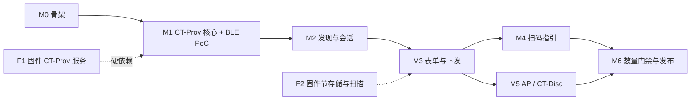

# NeoLink Windows 桌面版开发计划

| 项目 | 内容 |
| --- | --- |
| 文档状态 | Draft v1.0 |
| 更新日期 | 2026-10-29 |
| 目标平台 | Windows 10/11（P0 首发平台） |
| 技术基线 | Flutter Desktop + 共享 Dart 领域层（见 [`NEOLINK_TECH_SELECTION.md`](./NEOLINK_TECH_SELECTION.md)） |
| 配套设备端 | NE101（ESP32-S3）CT-Prov/1 固件实现（本仓库） |

本计划把技术设计拆成可执行的里程碑：每个里程碑给出任务清单和验收标准，验收直接引用技术设计 §13 的门禁条目，不重新定义。工期为单人全栈的粗估，按实际人力调整。

## 1. 首版范围

**做（P0）**：

- 启动环境自检（蓝牙、Wi-Fi AP 枚举、网卡与权限），通道受限时降级标注。
- 三路扫描：BLE、设备 AP、CT-Disc，归一化为候选并标注发现来源。
- 扫码指引：图片导入解码（正式兜底路径），`ctdev://guide-v1` 严格解析，指引页定向扫描并高亮命中候选。
- BLE 配置连接：读取 `device.info` 与 `communication.capabilities`。
- 能力驱动表单：`wifi` / `cellular` / `halow` / `comm` / `mqtt` / `webhook` 节，按 `fields` 门控。
- 无事务下发：单次 `config.set` 幂等覆盖写，结果页展示 `stored` 与 `apply` 提示。
- UI 文案中英双语：zh 模板 ARB + en，语言为工具设置项（决策 C-12）。
- 数据生命周期：除工具设置外不落盘，任务结束清理。

**不做（首版非目标）**：

- 移动端（P1）、macOS/Linux（P2/P3）。
- 相机扫码（增强能力，可在 M4 后视 PoC 补充）。
- 设备库、历史记录、OTA、批量管理。
- 静态 IP、联网生效验证（协议非目标）。

## 2. 工作流与前置依赖

两条工作流并行推进：

| 工作流 | 内容 | 载体 |
| --- | --- | --- |
| A 桌面端 | Flutter 应用 + 共享领域包 | 新仓库 `neolink/`（结构见技术设计 §5） |
| B 设备端 | NE101 固件实现 CT-Prov/1 v2.0 GATT 服务 | 本仓库 `main/`（替换现有 BLE demo） |

**设备端现状与前置**：现有 `main/ble_prov_demo.c`（约 340 行）只是 NimBLE 透传壳——有 GATT 读写特征与 MTU 事件，没有 JSON 编解码、分片重组、CRC 和操作集。设备端需要按 [`CT_PROV_PROTOCOL.md`](./CT_PROV_PROTOCOL.md) 完整实现（见 F1/F2），这是 M1 实机 PoC 的硬依赖。

**NE301 形态来源**：NE301 的 CT-Prov BLE 固件不在首版范围。桌面端用 `ct_prov_core` 内的 fake transport + 测试向量覆盖 NE301 形态（含 `comm` 选择器、`bssid`/`roaming`/`secret` 字段门控），NE301 固件就绪后补实机验证。

## 3. 里程碑总览

| 里程碑 | 内容 | 工期（估） | 关键验收 |
| --- | --- | --- | --- |
| M0 | 工程骨架与设计系统 | 1 周 | Win10/11 构建、主题切换、CI 绿 |
| M1 | CT-Prov 核心 + BLE 实机 PoC | 3 周 | 协议向量 100%、实机 roundtrip、**G1 决策点** |
| M2 | 发现与配置会话 | 2 周 | 扫描→连接→能力全链路、通道降级 |
| M3 | 配置表单与下发 | 3 周 | §13.3 + §13.4 全用例 |
| M4 | 扫码指引 | 1 周 | §13.2 全用例 |
| M5 | AP 与 CT-Disc 通道 | 2 周 | §13.1 三路扫描全表 |
| M6 | 数量门禁与发布 | 2 周 | §13.5 门禁记录归档、安装包 |
| F1 | 固件：CT-Prov 服务 | 3 周（与 M0–M1 并行） | 广告/分片/CRC/操作集实机可测 |
| F2 | 固件：节存储与扫描 | 2 周（与 M2–M3 并行） | config.set→NVS 映射、Wi-Fi 扫描 |

合计：单人全栈约 **14 周**；两人分工（桌面 UI/领域 ‖ 协议/适配器 + 固件）约 **9–10 周**。

## 4. 里程碑详述

### M0 工程骨架与设计系统（1 周）

任务：

1. 建立 `neolink/` 仓库：`apps/desktop_app` + `packages/*`（先建空壳：`ct_prov_core`、`discovery_domain`、`provisioning_session`、`communication_domain`、`neolink_ui`、`test_vectors`）。
2. `neolink_ui` 落自有 **NL 设计系统**：OKLCH 令牌（亮/暗）、卡片/按钮/徽章/骨架屏/下划线 tabs、字体（Plus Jakarta Sans + Noto Sans SC + JetBrains Mono）。
3. CI（GitHub Actions Windows runner）：`flutter analyze` + `flutter test` + `flutter build windows`。
4. 应用空壳：侧栏导航、主题切换、页面占位。
5. 中英双语：`flutter_localizations` + `gen-l10n`（ARB，zh 模板），壳应用全部文案经 `AppLocalizations`，顶栏语言切换；`neolink_ui` 不硬编码文案（决策 C-12）。

验收：Win10 与 Win11 均能构建运行；亮暗主题切换；中英文即时切换；CI 三项全绿。

### M1 CT-Prov 核心 + BLE 实机 PoC（3 周，关键路径）

任务：

1. `ct_prov_core`：分片协议（seq/重组/CRC）、JSON 信封编解码、六个操作（`device.info.get` / `communication.capabilities.get` / `communication.scan` / `config.set` / `config.get` / `session.close`）、九个错误码、cursor 分页。
2. `test_vectors`：从协议文档 §15 测试矩阵生成黄金向量（含 MTU 23 最大消息 3825B 分片、坏 CRC、未知 op）。
3. `ble_adapter`（`universal_ble` 候选）：按 Service Data 过滤扫描、连接、MTU 协商、写特征 + 通知接收。
4. 与 F1 固件联调：实机 `device.info.get` → `communication.capabilities.get` roundtrip。
5. 验证协议 §4.4 无绑定加密配对。

**G1 决策点（M1 末）**：`universal_ble` 通过实机门禁（roundtrip、MTU 23、睡眠恢复后重连）→ 冻结插件；任一项不达标 → 切换 Tauri + Rust BLE Adapter（领域包与测试向量不变，只重写适配器）。

验收：协议向量单测 100% 通过；实机 roundtrip 稳定（连续 50 次无失败）；G1 结论记录进决策表（C-09）。

### M2 发现与配置会话（2 周）

任务：

1. `discovery_domain`：BLE 源接入，`DiscoveryCandidate` 归一化；AP / CT-Disc 预留接口。
2. `provisioning_session`：统一状态机（`SelfChecking → Scanning → … → Cleaning`，见技术设计 §11），错误流 `protocol.error`，资源释放。
3. 环境自检：蓝牙适配器/无线电/权限、Wi-Fi AP 枚举能力、网卡枚举；某通道受限 → 降级标注，其余通道继续。
4. UI：环境自检页（启动自动执行）、扫描页（三路状态、BUSY 候选）、连接骨架屏、配置节页（勾选加入本次下发）。

验收：扫描→连接→读能力全链路；「AP 枚举受限」显示为能力限制而非空列表（§13.1）；候选超时刷新后底层资源同步清理。

### M3 配置表单与下发（3 周）

任务：

1. `communication_domain`：节 schema（七个节）、`fields` 门控、字段校验（长度/枚举/必填）。
2. `config.set` 幂等下发；结果页 `stored` + `apply`；失败保留表单供修改重试（`FIELD_NOT_SUPPORTED` 标注不支持字段）。
3. `communication.scan`：Wi-Fi 扫描列表 + cursor 分页 + 隐藏网络入口。
4. UI：wifi/cellular/halow/comm/mqtt/webhook 表单、服务 tabs、payload 预览。
5. NE301 fake transport：覆盖 `comm` 选择器与 `bssid`/`roaming`/`secret` 门控用例。

验收：技术设计 §13.3（四模式必测项）与 §13.4（服务节用例表）全部通过；NE101 实机 + NE301 fake 双形态。

### M4 扫码指引（1 周）

任务：

1. `qr_guide_adapter`：文件选择器 + 图片解码（正式路径）。
2. `ctdev://guide-v1` 严格解析：按 QR 规范 §8 校验（拒绝未知/重复/缺失字段、超 128 字节、位图保留位、非法十六进制）。
3. UI：扫描首页扫码面板（同页）、指引页（内置 `guide_id` 内容）、定向扫描命中后高亮候选 → 用户确认连接。

验收：技术设计 §13.2 全部用例（未知 Guide ID 显示通用指引、指引期间设备出现自动返回并高亮等）。

### M5 AP 与 CT-Disc 通道（2 周）

任务：

1. `ap_discovery_adapter`：平台网络 API SSID 枚举；受限时引导系统 Wi-Fi 页并降级标注。
2. `ct_disc_adapter` + `ct_disc_transport`：`dart:io` 网卡枚举、广播/受控单播、网卡选择 UI。
3. `softap_transport`：设备 AP HTTP Provisioning API，实现与 BLE 相同的会话语义。
4. 三源汇总去重：相同型号 + MAC 后缀保持独立候选，来源不串扰。

验收：技术设计 §13.1 三路扫描全表（含多网卡/VPN/虚拟网卡并存的接口选择与展示）。

### M6 数量门禁与发布（2 周）

任务：

1. §13.5 数量门禁：连续 100 次「扫描—连接—读能力—配置—确认 stored—关闭」；BLE 断链三时点（连接建立后/能力读取中/config.set 响应前）；完成、超时、重启后无设备历史残留；Release 日志白名单审计。
2. 打包：MSIX 安装包、版本号、（自签名起步，正式签名后续）。
3. 发布检查单与门禁记录归档。

验收：门禁执行记录归档到仓库；`flutter build windows --release` 产物在干净 Win10/Win11 虚机上完成一次全流程。

### F1 固件：CT-Prov 服务（3 周，与 M0–M1 并行）

任务：

1. 按协议 §4 实现 GATT 服务：UUID、广播（Flags + Service Data，MODEL-MAC_SUFFIX）、META 特征、no-bonding 加密。
2. 分片重组与 CRC 校验（D2C/C2D 双向）。
3. JSON 编解码（cJSON 或等价）+ 操作分发 + 九错误码。
4. `device.info.get` / `communication.capabilities.get` 先行（联调依赖）。

验收：可与桌面端 M1 完成 roundtrip；MTU 23 下 3825B 消息分片重组正确。

### F2 固件：节存储与扫描（2 周，与 M2–M3 并行）

任务：

1. `config.set` 节 → NVS 映射（按 CT_CONFIG_SCHEMA §10 的 NE101 键位：`wifi:ssid`、`cat1:*`、`push:mode`、`mqtt:*`、`dev:netmod` 等），整请求原子校验、全部通过才写入。
2. `config.get` 回读（密码不回明文）、`communication.scan`（Wi-Fi 扫描结果 + cursor 分页）。
3. `session.close` 与断链清理。

验收：NE101 实机通过 M3 全部用例；重复提交相同配置幂等。

## 5. 测试与门禁策略

| 层级 | 内容 | 执行 |
| --- | --- | --- |
| 协议向量单测 | `ct_prov_core` 编解码/分片/CRC/错误码黄金向量 | CI 每次构建 |
| 领域包单测 | 状态机迁移、schema 门控与校验、cursor 分页 | CI 每次构建 |
| Widget 测试 | 环境自检、扫描、表单、下发结果关键页 | CI 每次构建 |
| 实机手工门禁 | 技术设计 §13.1–§13.5 清单，逐条记录（日期/机器/结果） | 里程碑验收 + M6 全量 |

原则：能在向量层断言的不留到 UI 层；能在 fake transport 覆盖的不占用实机；实机门禁只验证平台行为（BLE 栈、网卡、权限）。

## 6. 决策点与风险

| 编号 | 决策点/风险 | 触发条件 | 应对 |
| --- | --- | --- | --- |
| G1（M1 末） | `universal_ble` 冻结 vs 切 Tauri + Rust | 实机 roundtrip / MTU 23 / 睡眠恢复任一不达标 | 切换只重写 BLE 适配器，领域包与向量不变（C-02/C-09） |
| R1 | 固件侧（F1/F2）延期 | M1 联调窗口前未完成 roundtrip 操作 | 桌面端先用 fake transport 推进 M2/M3，实机验证后移 |
| R1-NE301 | NE301 实机缺失 | — | fake transport + 向量覆盖形态差异，实机后补 |
| R2 | Windows BLE 栈差异（驱动、缓存） | 门禁机器矩阵出现平台性失败 | 保留硬件矩阵记录；G1 提前触发 |
| R3 | AP 枚举受限误报为「无设备」 | §13.1 用例失败 | 能力限制显式建模（自检结果驱动通道标注），代码审查禁止映射成空列表 |
| R4 | 服务凭据入日志或落盘 | 日志审计发现 | 白名单日志器 + 数据生命周期表（技术设计 §12）作为审查清单 |
| R5 | 发现通道与通讯模式字段混用 | 代码审查 | 两套枚举（`DiscoveryChannel`/`CommunicationMode`）禁止互转 |

## 7. 排期估算

- **单人全栈**：约 14 周（M0–M6 串行 + 固件穿插）。
- **两人分工**：约 9–10 周——A：桌面 UI + 领域包（M0→M2→M3→M4/M6）；B：协议核心 + 适配器 + 固件（F1→M1→F2→M5→M6）。
- 估算前提：协议文档保持 v2.0 冻结不再变更；每周按 5 个有效工作日；不含正式代码签名与商店分发流程。

## 8. 参考文档

- [NeoLink 桌面端与移动端技术设计](./NEOLINK_TECH_SELECTION.md)：架构、门禁（§13）、决策记录
- [NeoLink 产品与设备通讯配置流程](./NEOLINK_PRODUCT_FLOW.md)：页面与流程范围
- [CT-Prov/1 协议](./CT_PROV_PROTOCOL.md)：操作集、分片、错误码、测试矩阵
- [CT-Prov/1 配置数据结构](./CT_CONFIG_SCHEMA.md)：节 schema 与 NE101 NVS 映射
- [CT Device Guide QR](./CT_DEVICE_QR_SPEC.md)：`ctdev://guide-v1` URI 与严格解析规则
- [UI 原型](./neolink_ui_mockup.html)：页面结构与交互基准（环境自检、扫码同页、能力驱动表单）
